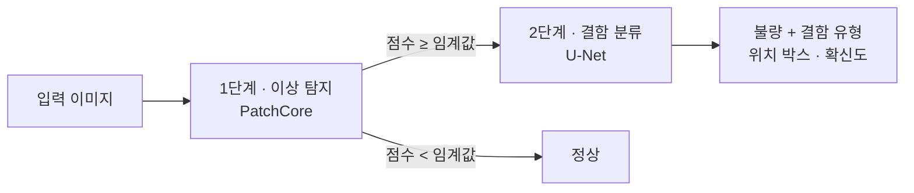
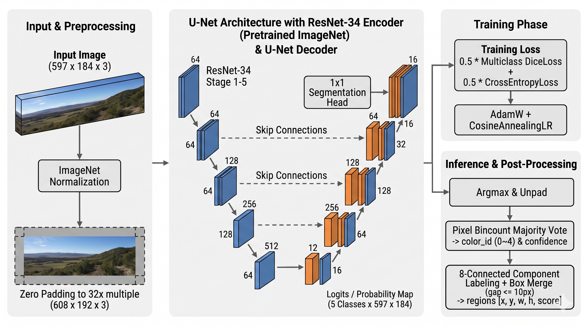
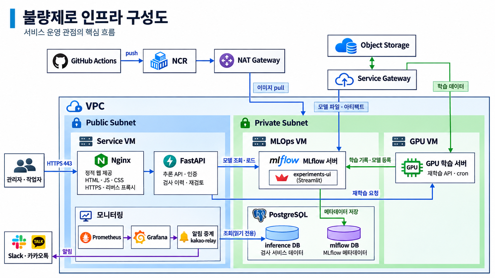
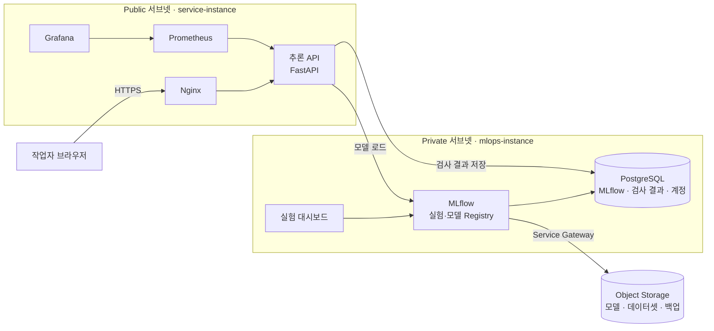
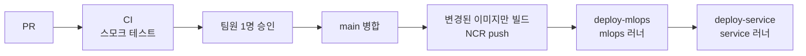

<div align="center">

# 🏭 불량제로 (ZeroDefect)

**표면 결함 이미지에서 불량을 찾아내고, 결함 유형까지 분류하는 검사 모델과 MLOps 파이프라인**

NHN Cloud AI 팩토리 MLOps 부트캠프 팀 프로젝트 · 2026.10.29 – 11.25

<br>

[](https://github.com/1230seongjun/ksdd2-mlops/actions/workflows/ci.yaml)
[](https://github.com/1230seongjun/ksdd2-mlops/actions/workflows/deploy.yaml)


<br>


<br>

[소개](#-프로젝트-소개) · [검사 방식](#-검사-방식) · [모델](#-모델) · [아키텍처](#-아키텍처) · [CI/CD](#-cicd) · [시작하기](#-시작하기) · [로드맵](#-로드맵) · [팀](#-팀)

</div>

<br>

## 📖 프로젝트 소개

생산 라인의 마지막 검사 공정을 가정했습니다. 작업자가 눈으로 판단하기 어려운 표면 결함을 **놓치지 않는 것**을 최우선 목표로, 검사 모델부터 배포 · 모니터링 · 재학습까지 이어지는 MLOps 흐름을 직접 구성했습니다.

| | 내용 |
|---|---|
| 🎯 **목표** | 결함 재현율 98% 이상을 지키면서 오경보 줄이기 |
| 🧪 **데이터** | [KolektorSDD2](https://www.vicos.si/resources/kolektorsdd2/) 표면 결함 이미지 (CC BY-NC-SA 4.0) |
| 🔍 **검사** | 이상 탐지로 불량을 거르고, 불량만 결함 유형(4종) 분류 |
| ⚙️ **운영** | 학습 → Registry 등록 → 자동 배포 → 추론 → 결과 저장 → 성능 감시 → 재학습 |

### 🌟 핵심 기능

- **2단계 검사:** 이상 탐지(PatchCore)로 불량을 거르고, 불량만 U-Net으로 결함 유형 · 위치까지 분류
- **재현 가능한 실험:** 시드 42 고정 분할과 분할 해시를 MLflow에 기록해, 같은 조건의 실험끼리만 비교
- **자동 배포 · 롤백:** main 병합 시 바뀐 이미지만 빌드해 배포하고, 헬스체크 실패 시 직전 버전으로 자동 복원
- **분리된 네트워크:** 외부 공개는 HTTPS 입구 하나, 실험 기록 · DB는 공인 IP 없는 Private 서브넷
- **검사 이력 · 모니터링:** 로그인한 작업자별 검사 결과를 DB에 쌓고, 지표 대시보드와 이메일 알림으로 감시

### ✨ 주요 결과

| 지표 | 값 | 비고 |
|:---:|:---:|---|
| **AP** | **0.981** | 이상 탐지 검증 데이터 기준 |
| **재현율** | **0.986** | 목표 98% 달성 |
| **정밀도** | **0.787** | 재현율 98% 지점에서 |

### 📅 진행 단계

`문제 정의` → `데이터 · 설계` → `베이스라인 · PoC` → `모델 · 설계 개선` → `서빙 · 통합` → `최종 정리 · 발표`

<br>

---

## 🔍 검사 방식

이미지 한 장을 **두 단계**로 판정합니다.



| 단계 | 모델 | 하는 일 | Registry 이름 |
|---|---|---|---|
| 1 | **PatchCore** (Wide ResNet50-2) | 정상 이미지만으로 학습해 이상 점수를 매기고 정상 · 불량 판정 | `Zero-Defects` |
| 2 | **U-Net** (ResNet34 인코더) | 불량 이미지만 픽셀마다 결함 색을 칠해 유형 · 위치 · 확신도 반환 | `Zero-Defects-Classifier` |

> **결함 유형:** 갈적색 · 흑색 · 청색 · 표면
> 결함을 찾지 못하면 유형은 비워 두고, 판정(불량)은 그대로 유지합니다. 서비스는 Registry의 `champion` 별칭이 붙은 버전을 불러옵니다.

<br>

---

## 🧠 모델

### 1단계 · 이상 탐지 (PatchCore)

<!-- 이상 탐지 구조 이미지는 모델 확정 후 추가:  -->

- **특징 추출:** 사전학습된 Wide ResNet50-2의 layer2 · layer3 출력을 합쳐, 이미지 한 장을 1536차원 패치 1,725개로 바꿉니다.
- **학습:** 정상 이미지의 패치 30만 개 중 coreset으로 1만 개를 골라 메모리 뱅크로 저장합니다. 역전파는 없습니다.
- **판정:** 패치마다 가장 가까운 정상 패치까지의 거리를 구하고, 최댓값이 임계값(검증 데이터 재현율 98% 지점) 이상이면 불량입니다.

<details>
<summary><b>파인튜닝 (선택)</b></summary>
<br>

정상 이미지에 가짜 결함(가는 선 · 얼룩)을 그려 넣고, 패치가 가짜 결함인지 맞히는 작은 헤드와 함께 **layer3 마지막 3블록의 conv 가중치만** 학습합니다.

- 학습률 1e-5, 5에폭, BatchNorm 고정
- 결함이 아닌 곳의 특징이 원래에서 멀어지지 않게 붙잡는 손실(anchor)을 더함
- 에폭마다 메모리 뱅크를 다시 만들어 검증 AP가 가장 좋은 에폭을 선택하고, 좋아지지 않으면 파인튜닝 전 가중치를 그대로 사용

</details>

<br>

### 2단계 · 결함 유형 분류 (U-Net)



- **구조:** ImageNet 사전학습 ResNet34 인코더 + 디코더 5단계(skip 연결)로 픽셀마다 5개 클래스(배경 + 결함 4종)를 예측합니다.
- **입력:** 32의 배수가 되도록 608 × 192로 패딩하고, 출력은 원래 크기로 잘라 씁니다.
- **결과:** 가장 많이 칠한 색이 결함 유형, 그 픽셀들의 확률 평균이 확신도입니다. 색별로 이어진 영역마다 위치 박스를 만듭니다.

<br>

### 모델 개발 과정

<details>
<summary><b>📂 데이터 준비</b></summary>
<br>

| 작업 | 내용 |
|---|---|
| 크기 통일 | 가장 작은 크기에 맞춰 리사이즈. 평균값 패딩은 원본에 없는 값이 들어가 폐기 |
| 정합성 정리 | 리사이즈로 결함이 잘려 사라진 이미지, 팀원 간 데이터 개수 차이를 찾아 제거 |
| 라벨 검수 | 팀 전체가 육안 검수. 애매한 이미지는 데이터셋 원저작자에게 직접 문의해 확인 |
| 분할 | 시드 42 고정. 정상 70 / 15 / 15, 결함은 검증 · 테스트에만 50 / 50. 분할 해시(`split_hash`)를 MLflow에 기록 |

</details>

<details>
<summary><b>📏 평가 원칙</b></summary>
<br>

- 모델 선택과 임계값은 **검증 데이터로만** 정하고, 테스트는 최종 모델에 대해 **한 번만** 평가합니다.
- 주요 지표는 AP와 **재현율 98% 지점의 정밀도**입니다. 결함을 놓치지 않는 것을 우선하고, 그 조건에서 오경보가 적은 모델을 고릅니다.
- 초기에 테스트 결과로 모델을 비교하던 것을 발견해, 검증만으로 고르도록 코드를 고쳤습니다.

</details>

<details>
<summary><b>🧪 이상 탐지 모델 선정 과정</b></summary>
<br>

| 실험 | 결과 |
|---|---|
| PatchCore + ResNet18 베이스라인 | 출발점. 일반 정규화가 ImageNet 정규화보다 나음 |
| 메모리 뱅크 10만 → 40만 패치 | 소폭 상승, 학습 시간 대비 효과 작음 |
| 데이터 증강 (회전, 밝기 · 대비 · 노이즈) | 베이스라인보다 낮음 |
| 이미지 필터 8종 (Canny, Sobel, CLAHE 등) | 유의미한 개선 없음 |
| 이상 점수 방식 (최댓값 → 상위 k개 평균) | 개선 없음 |
| 다른 알고리즘 (SPADE, PaDiM) · DINOv3 백본 | PatchCore보다 낫지 않음 |
| **PatchCore + Wide ResNet50-2 (ImageNet V1)** | ✅ **오경보가 가장 적음 → 최종 모델** |
| 가짜 결함으로 layer3 파인튜닝 | 검증 AP가 좋아질 때만 적용 |

</details>

<details>
<summary><b>🏷️ 결함 유형 분류 모델 학습</b></summary>
<br>

- **라벨:** 원본에는 결함 영역 마스크만 있고 유형 라벨은 없습니다. 원저작자에게 원래 분류 체계를 확인한 뒤 팀이 직접 다시 라벨링했고, 주요 · 경미의 경계가 애매해 둘을 합쳐 4종으로 정했습니다.
- **정답:** 라벨링 도구로 그린 결함 박스(bbox)를 정답 마스크로 쓰고, 정상 이미지는 "전부 배경"으로 함께 학습합니다.
- **분할:** 테스트 20% + 나머지 5-fold 교차검증 (시드 42, 유형 비율 유지)
- **학습:** Dice 0.5 + CrossEntropy 0.5 · AdamW 3e-4 (cosine → 1e-6) · 최대 60에폭, 15에폭 조기 종료 · 좌우 · 상하 뒤집기
- **평가:** 전체 정확도(결함 색 + 정상을 안 칠한 비율), 결함 색 정확도, 위치 Dice

</details>

<details>
<summary><b>💻 학습 환경</b></summary>
<br>

- GPU 인스턴스는 기존 스토리지를 붙일 수 없고 1시간 단위로 과금되어, **팀원 노트북 GPU(RTX 5050)** 를 학습 서버로 씁니다.
- 학습 데이터는 비공개 Object Storage 버킷에서 내려받아 쓰고, 접근 키는 학습 PC의 `.env`에만 둡니다.
- 노트북을 GitHub Actions 셀프 호스티드 러너로 등록해, 학습 코드 병합 → 학습 → MLflow 기록까지 이어지게 구성하고 있습니다.

</details>

<br>

---

## 🌐 아키텍처

NHN Cloud VPC를 **Public · Private 서브넷**으로 나누고, 인스턴스 2대에 역할을 나눴습니다.



| 구성 | 위치 | 역할 |
|---|---|---|
| **Nginx · 추론 API · 검사 화면** | service-instance (Public) | 외부에 열린 유일한 입구 (HTTPS) |
| **Prometheus · Grafana** | service-instance | API 지표 수집, 대시보드, 성능 저하 시 이메일 알림 |
| **MLflow · PostgreSQL · 실험 대시보드** | mlops-instance (Private) | 공인 IP 없음. `mlflow` DB와 검사 결과용 `inference` DB를 따로 둠 |
| **Object Storage** | NHN 관리형 | 모델 파일, 데이터셋(비공개), DB 백업 |

> 🔒 mlops-instance는 바깥으로 나갈 때만 NAT 게이트웨이를, Object Storage에는 Service Gateway(NHN 내부망)를 거칩니다. 팀원 SSH와 MLflow 접속은 service-instance를 점프 서버로 거칩니다.

<details>
<summary><b>텍스트로 보기 (Mermaid)</b></summary>



</details>

### 🖥️ 검사 화면

| 기능 | 내용 |
|---|---|
| 접속 | `https://<서비스 주소>` · 검사하려면 로그인 필요 |
| 계정 | 초대제. 관리자가 초대 링크를 만들면 작업자가 비밀번호를 정해 가입 (argon2 해시 저장) |
| 검사 이력 | 판정 · 이상 점수 · 결함 유형 · 확신도 · 처리 시간 저장. 작업자는 자기 이력, 관리자는 전체 이력 |
| 장애 격리 | DB 저장이나 결함 분류가 실패해도 정상 · 불량 판정은 그대로 반환 |

<br>

---

## 🔄 CI/CD



| 규칙 | 내용 |
|---|---|
| 🛡️ **main 보호** | 직접 push 금지 · PR 필수 · CI 통과 · 작성자가 아닌 팀원 1명 승인 |
| 🏷️ **이미지 태그** | 커밋 SHA 앞 7자리만 사용 (`latest` 미사용) |
| 🚀 **배포** | 인스턴스별 셀프 호스티드 러너가 `deploy_stack.sh`로 배포. MLOps 스택을 먼저 배포 |
| ↩️ **롤백** | 헬스체크 실패 시 직전 태그(`.env.prev`)로 자동 복원 |
| 🧹 **정리** | 서버는 현재 · 직전 태그만 남김, NCR은 30일 기준 정리 정책 |
| 🖐️ **수동 실행** | `all` · `api` · `mlflow` · `experiments-ui` · `deploy-only` |

> 셀프 호스티드 러너는 PR에서 실행하지 않습니다 (main push와 수동 실행만).

<br>

---

## 📁 저장소 구조

```
.github/
├── workflows/        CI(ci.yaml) · 배포(deploy.yaml) · 점검용 워크플로
└── scripts/          서버 배포 스크립트 (deploy_stack.sh)
infra/
├── mlops/            MLflow · PostgreSQL · 실험 대시보드
└── service/          Nginx · Prometheus · Grafana
serving/
├── api/              추론 API (FastAPI)
├── web/              검사 화면 (로그인 · 검사 이력)
└── tests/            PR마다 실행하는 스모크 테스트
model/
├── 이상치 모델/       이상 탐지 학습 (PatchCore)
├── 분류 모델/         결함 유형 분류 학습 (U-Net)
└── common.yaml       두 모델 공통 설정
docs/                 README 이미지
```

> 각 스택의 실행 방법과 설정은 폴더별 README(`infra/mlops`, `infra/service`, `serving/api`)에 있습니다.

<br>

---

## 🚀 시작하기

### 모델 학습 (학습 PC)

```bash
# 1. MLflow 접속용 SSH 터널 (service-instance를 거쳐 mlops-instance로)
ssh -J <service 계정>@<service 주소> -L 5000:127.0.0.1:5000 <mlops 계정>@<mlops 사설 주소>

# 2. 모델 폴더에 .env 준비 (저장소에 올리지 않음)
#    OBJECT_STORAGE_ACCESS_KEY, OBJECT_STORAGE_SECRET_KEY, MLFLOW_TRACKING_URI=http://127.0.0.1:5000

# 3-a. 이상 탐지 학습 → 검증 지표 기록 (SAVE_MODEL: true 면 Registry 등록)
cd "model/이상치 모델"
python train.py --config config.yaml

# 3-b. 결함 유형 분류: fold 별 학습 후 5-fold 결과 요약
cd "model/분류 모델"
python train.py --config config.yaml --fold 0      # fold 0~4
python summary.py
```

> 필요 패키지: PyTorch · torchvision · MLflow 3.6 · scikit-learn · boto3 · python-dotenv (분류 모델은 segmentation-models-pytorch · scipy 추가)

### 배포

| 방법 | 언제 |
|---|---|
| **자동** | `main`에 병합되면 바뀐 이미지만 빌드해 두 스택을 순서대로 배포 |
| **수동** | Actions → `Build and deploy` → 대상(`all` · `api` · `deploy-only` 등) 선택 |

배포가 끝나면 브라우저에서 `https://<서비스 주소>`로 접속해 로그인합니다.

<br>

---

## 🧭 로드맵

- [x] PatchCore 이상 탐지 · U-Net 결함 분류 모델
- [x] VPC Public / Private 분리, NAT · Service Gateway
- [x] GitHub Actions + 셀프 호스티드 러너 자동 배포 · 롤백
- [x] 로그인 · 검사 이력 · 검사 결과 DB 저장
- [x] HTTPS, NCR 이미지 정리 정책
- [ ] `champion` 별칭 기반 모델 교체 · 롤백
- [ ] 검사 결과 DB 기반 성능 저하 감지 → 이메일 알림
- [ ] 성능 저하 시 직전 모델로 자동 롤백
- [ ] 학습 노트북 러너 자동 재학습 (`train.yaml`)
- [ ] PostgreSQL 일일 백업 · 복구 테스트

<br>

---

## 🔐 설정과 비밀값

| 위치 | 담는 값 |
|---|---|
| **GitHub Secrets** | NCR 주소와 접속 키 |
| **서버 `.env`** | DB 비밀번호, Object Storage 키, SMTP 정보 등 (runner 소유, 권한 600) |
| **서버 `tls/`** | HTTPS 인증서 (서버에만 두고 배포 동기화에서 제외) |

- 저장소에는 비밀값을 올리지 않습니다. CI가 `.env`, 키 파일이 올라오면 실패하도록 검사합니다.
- `/opt/bulryangzero/`는 배포 스크립트가 관리하는 실행본이라 직접 고치지 않고, 변경은 PR로 합니다.

<br>

---

## 📊 데이터

- **KolektorSDD2:** https://www.vicos.si/resources/kolektorsdd2/
- **라이선스:** CC BY-NC-SA 4.0

> ⚠️ 원본 이미지와 이를 변형한 이미지, 재라벨링 데이터는 이 저장소에 포함하지 않습니다. 데이터셋은 비공개 Object Storage 버킷에 버전별로 보관합니다.

<br>

---

## 📚 참고 · 감사의 말

- 데이터셋 **KolektorSDD2**를 공개하고, 결함 분류 체계에 대한 문의에 답해 주신 원저작자께 감사드립니다.
- 데이터셋 인용:

```bibtex
@article{Bozic2021COMIND,
  author  = {Bo{\v{z}}i{\v{c}}, Jakob and Tabernik, Domen and Sko{\v{c}}aj, Danijel},
  title   = {Mixed supervision for surface-defect detection: from weakly to fully supervised learning},
  journal = {Computers in Industry},
  year    = {2021}
}
```

- PatchCore: Roth et al., *Towards Total Recall in Industrial Anomaly Detection*, CVPR 2022
- U-Net 구현: [segmentation_models.pytorch](https://github.com/qubvel-org/segmentation_models.pytorch)

<br>

---

## 👥 팀

| 조성준 | 우성윤 | 장준환 | 김찬희 | 지연궁 |
|:---:|:---:|:---:|:---:|:---:|
| 팀장 · CI/CD | MLOps 스택 | 서비스 스택 · API | 데이터 · 모델 | 데이터 · 모델 |
