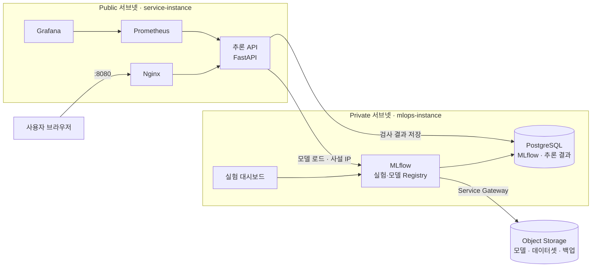
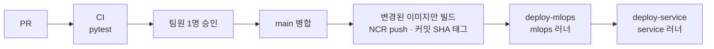

# 불량제로 (ZeroDefect)

KolektorSDD2 표면 결함 이미지로 **결함을 찾아내고(이상 탐지) 결함 유형까지 분류하는** 검사 모델과, 이를 학습·배포·모니터링하는 MLOps 파이프라인입니다.

NHN Cloud AI 팩토리 MLOps 부트캠프 팀 프로젝트 (2026.10.29 – 11.25)

## 검사 방식

이미지 한 장을 두 단계로 판정합니다.

1. **이상 탐지 (PatchCore, Wide ResNet50):** 정상 이미지만으로 학습한 모델이 이상 점수를 매겨 정상·불량을 판정합니다. 임계값은 검증 데이터에서 재현율 98% 이상이 되도록 정합니다.
2. **결함 유형 분류 (U-Net 분할):** 불량으로 판정된 이미지만 결함 영역을 찾아 유형(갈적색 · 흑색 · 청색 · 표면)을 분류합니다. 이상 탐지가 정상을 불량으로 잘못 본 경우를 다시 걸러 오검출을 줄입니다.

| 모델 | MLflow Registry 이름 |
|---|---|
| 이상 탐지 | `Zero-Defects` |
| 결함 유형 분류 | `Zero-Defects-Classifier` |

서비스에서는 Registry의 `champion` 별칭이 붙은 버전을 불러옵니다.

## 아키텍처

NHN Cloud VPC를 Public·Private 서브넷으로 나누고 인스턴스 2대에 역할을 나눴습니다.



| 구성 | 위치 | 설명 |
|---|---|---|
| Nginx · 추론 API · 검사 화면 | service-instance (Public) | 외부에 열린 유일한 입구 (:8080) |
| Prometheus · Grafana | service-instance | 서버 내부에서만 접속, 성능 저하 시 이메일 알림 |
| MLflow · PostgreSQL · 실험 대시보드 | mlops-instance (Private) | 공인 IP 없음, service-instance에서만 접근 |
| Object Storage | NHN 관리형 | 모델 파일, 데이터셋(비공개 버킷), DB 백업 |

- mlops-instance가 GitHub·NCR로 나갈 때는 NAT 게이트웨이를, Object Storage에 접근할 때는 Service Gateway(NHN 내부망)를 거칩니다.
- 팀원 SSH 접속과 MLflow 접속은 service-instance를 점프 서버로 거칩니다 (`ssh -J`).

## 저장소 구조

```
.github/
  workflows/        CI(ci.yaml) · 배포(deploy.yaml) · 점검용 워크플로
  scripts/          서버 배포 스크립트 (deploy_stack.sh)
infra/
  mlops/            MLOps 스택: MLflow · PostgreSQL · 실험 대시보드  → infra/mlops/README.md
  service/          서비스 스택: Nginx · Prometheus · Grafana       → infra/service/README.md
serving/
  api/              추론 API (FastAPI)                                → serving/api/README.md
  web/              검사 화면 (정적 HTML)
  ui/               Streamlit 결과 화면
  tests/            PR마다 실행하는 스모크 테스트
model/              모델 학습 코드 (이상 탐지 · 결함 유형 분류)
```

각 스택의 실행 방법과 설정은 폴더별 README에 있습니다.

## CI/CD



- **main 보호:** 직접 push 금지, PR 필수, CI 통과 필수, 작성자가 아닌 팀원 1명 승인 필요
- **이미지 태그:** 커밋 SHA 앞 7자리만 사용하고 `latest`는 쓰지 않습니다.
- **배포:** 인스턴스마다 설치한 셀프 호스티드 러너가 `.github/scripts/deploy_stack.sh`로 배포합니다. API가 시작할 때 MLflow에서 모델을 불러오므로 MLOps 스택을 먼저 배포합니다.
- **롤백:** 헬스체크가 실패하면 직전 태그(`.env.prev`)로 자동 복원합니다.
- **정리:** 배포가 성공하면 서버에는 현재·직전 태그 이미지만 남기고, NCR은 30일 기준 정리 정책을 적용합니다.
- **수동 실행:** Actions의 `Build and deploy`에서 `all` · `api` · `mlflow` · `experiments-ui` · `deploy-only`를 골라 실행할 수 있습니다.
- 셀프 호스티드 러너는 PR에서 실행하지 않습니다 (main push와 수동 실행만).

## 설정과 비밀값

- 저장소에는 비밀값을 올리지 않습니다. CI 테스트가 `.env`, 키 파일이 올라가면 실패하도록 검사합니다.
- **GitHub Secrets:** NCR 주소와 접속 키
- **서버 `.env`:** `/opt/bulryangzero/<stack>/.env` (runner 소유, 권한 600)에 DB 비밀번호, Object Storage 키, SMTP 정보 등 실행 값을 둡니다. 배포는 이미지 태그(`*_TAG`) 줄만 바꾸고 나머지 값은 그대로 둡니다.
- `/opt/bulryangzero/`는 배포 스크립트가 관리하는 실행본이라 직접 파일을 추가하거나 고치지 않습니다. 변경은 저장소에서 PR로 합니다.

## 데이터

- KolektorSDD2: https://www.vicos.si/resources/kolektorsdd2/
- 라이선스: CC BY-NC-SA 4.0. **원본 이미지와 이를 변형한 이미지는 이 저장소에 포함하지 않습니다.** 데이터셋은 비공개 Object Storage 버킷에 버전별로 보관합니다.

## 팀

| 이름 | 역할 |
|---|---|
| 조성준 | CI/CD · 인프라 (GitHub Actions, NCR, 러너, 배포·롤백, 네트워크) |
| 우성윤 | MLOps 스택 (MLflow, PostgreSQL, Object Storage, 백업) |
| 장준환 | 서비스 스택 (추론 API, 검사 화면, Prometheus · Grafana) |
| 김찬희 | 데이터 · 모델 (라벨링, 이상 탐지·분류 모델 학습) |
| 지연궁 | 데이터 · 모델 (라벨링, 이상 탐지·분류 모델 학습) |
