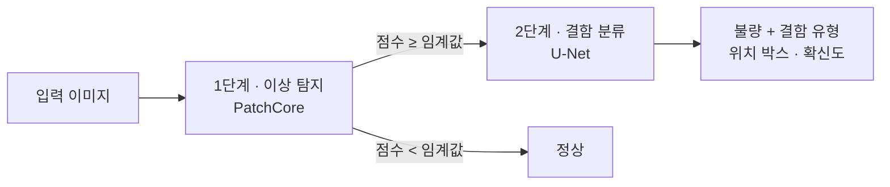
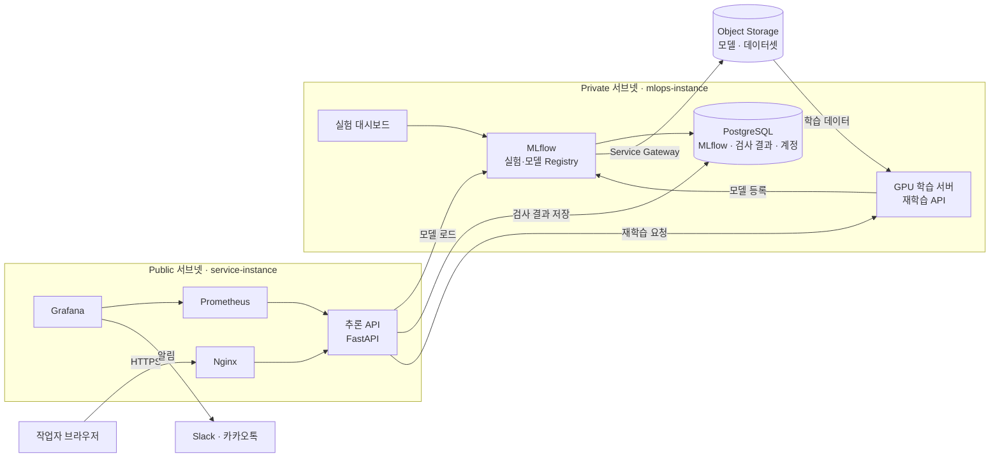
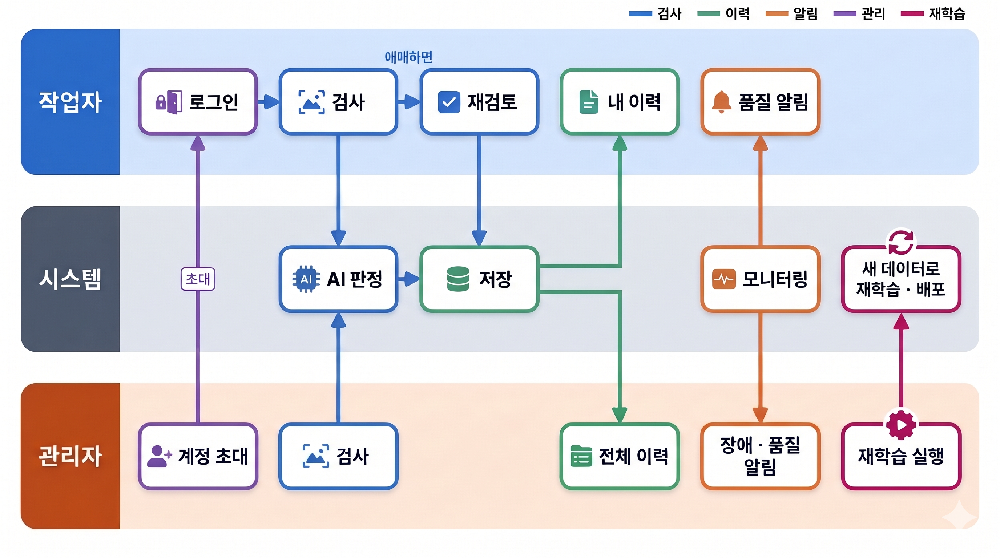
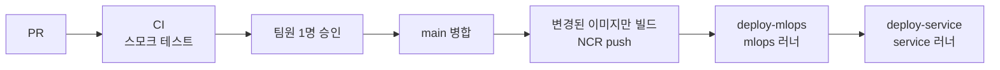

<div align="center">

# 🏭 불량제로 (ZeroDefect)

**표면 결함 이미지에서 불량을 찾아내고, 결함 유형까지 분류하는 검사 모델과 MLOps 파이프라인**

NHN Cloud AI 팩토리 MLOps 부트캠프 팀 프로젝트 · 2026.10.29 – 11.25

<br>

[](https://github.com/1230seongjun/ksdd2-mlops/actions/workflows/ci.yaml)
[](https://github.com/1230seongjun/ksdd2-mlops/actions/workflows/local-build.yaml)


<br>


<br>

[소개](#-프로젝트-소개) · [검사 방식](#-검사-방식) · [모델](#-모델) · [아키텍처](#-아키텍처) · [CI/CD](#-cicd) · [로컬에서 실행하기](#-로컬에서-실행하기) · [로드맵](#-로드맵) · [팀](#-팀)

</div>

<br>

## 📖 프로젝트 소개

생산 라인의 마지막 검사 공정을 가정했습니다. 작업자가 눈으로 판단하기 어려운 표면 결함을 **놓치지 않는 것**을 최우선 목표로, 검사 모델부터 배포 · 모니터링 · 재학습까지 이어지는 MLOps 흐름을 직접 구성했습니다.

| | 내용 |
|---|---|
| 🎯 **목표** | 결함 재현율 98% 이상을 지키면서 오경보 줄이기 |
| 🧪 **데이터** | [KolektorSDD2](https://www.vicos.si/resources/kolektorsdd2/) 표면 결함 이미지 (CC BY-NC-SA 4.0) |
| 🔍 **검사** | 이상 탐지로 불량을 거르고, 불량만 결함 유형(4종) 분류 |
| ⚙️ **운영** | 학습 → Registry 등록 → 자동 배포 → 추론 → 결과 저장 → 성능 감시 → 재학습 |

### 🌟 핵심 기능

- **2단계 검사:** 이상 탐지(PatchCore)로 불량을 거르고, 불량만 U-Net으로 결함 유형 · 위치까지 분류
- **재현 가능한 실험:** 시드 42 고정 분할과 분할 해시를 MLflow에 기록해, 같은 조건의 실험끼리만 비교
- **자동 배포 · 롤백:** main 병합 시 바뀐 이미지만 빌드해 배포하고, 헬스체크 실패 시 직전 버전으로 자동 복원
- **분리된 네트워크:** 외부 공개는 HTTPS 입구 하나, 실험 기록 · DB는 공인 IP 없는 Private 서브넷
- **사람과 함께하는 검사:** 불량 판정에서 위치나 유형을 확인하지 못하면 작업자가 정상 · 불량과 결함 유형을 확정하고 필요한 박스를 지정. 모델 원본 결과와 작업자 판단은 DB에 구분해 저장
- **검사 이력 · 모니터링:** 작업자별 검사 결과를 DB에 쌓고, 작업자 · 관리자 대시보드와 Slack · 카카오톡 알림(12개 규칙)으로 감시
- **재학습 · 자동 배포:** GPU 서버에서 매주 정기 재학습(cron)과 관리자 버튼 재학습을 지원하고, 새 모델은 MLflow 등록 후 자동 배포

### ✨ 주요 결과

| 단계 | 지표 | 값 | 비고 |
|:---:|:---:|:---:|---|
| 이상 탐지 | **AP** | **0.982** | 서빙 모델 v5, 검증 데이터 기준 |
| 이상 탐지 | **재현율** | **0.986** | 목표 98% 달성 |
| 이상 탐지 | **정밀도** | **0.830** | 재현율 98% 지점 (오경보 28장, 임계값 1.4025) |

### 📅 진행 단계

`문제 정의` → `데이터 · 설계` → `베이스라인 · PoC` → `모델 · 설계 개선` → `서빙 · 통합` → `최종 정리 · 발표`

<br>

---

## 🔍 검사 방식

이미지 한 장을 **두 단계**로 판정합니다.



| 단계 | 모델 | 하는 일 | Registry 이름 |
|---|---|---|---|
| 1 | **PatchCore** (Wide ResNet50-2) | 정상 이미지만으로 학습해 이상 점수를 매기고 정상 · 불량 판정 | `Zero-Defects` |
| 2 | **U-Net** (ResNet34 인코더) | 불량 이미지만 픽셀마다 결함 색을 칠해 유형 · 위치 · 확신도 반환 | `Zero-Defects-Classifier` |

> **결함 유형:** 갈적색 · 흑색 · 청색 · 표면
> 결함을 찾지 못하면 유형은 비워 두고, 판정(불량)은 그대로 유지합니다. 검사에 쓸 모델은 Registry에 등록된 버전 중에서 화면에서 고릅니다.

**위치나 유형을 확인하지 못하면 사람에게 넘깁니다.** API는 불량 판정에서 박스가 없거나 유효한 결함 유형이 없을 때 재검토로 분류합니다. 신뢰도 0.88 기준은 폐기했습니다. 결과 메타데이터를 대기 큐에 보관하고, 작업자가 최종 정상 · 불량을 확정하면 모델 원본 결과와 별도 판단 컬럼을 검사 이력에 저장합니다. 최종 불량에는 결함 유형이 필수이며 박스는 선택입니다. 원본 이미지 저장과 재학습 데이터 수집 완료는 이 저장 기능과 구분합니다.

| 출력 | 컬럼 |
|---|---|
| 이상 탐지 | `anomaly_score`(이상 점수) · `threshold`(임계값) · `is_defect`(결함 여부) |
| 결함 분류 | `color_id` · `color`(결함 유형) · `confidence`(확신도) · `regions`(위치) |

<br>

---

## 🧠 모델

### 1단계 · 이상 탐지 (PatchCore)

<!-- 이상 탐지 구조 이미지는 모델 확정 후 추가:  -->

- **특징 추출:** 이 데이터에 맞게 파인튜닝한 Wide ResNet50-2(ImageNet V1 가중치)의 layer2 · layer3 출력을 합쳐, 이미지 한 장을 1536차원 패치 1,725개로 바꿉니다. 이웃 패치는 3×3 평균으로 묶습니다.
- **학습:** 정상 이미지의 패치 30만 개 중 coreset(greedy k-center)으로 1만 개를 골라 메모리 뱅크로 저장합니다. 결함 이미지는 학습에 쓰지 않고, 임계값을 정하고 평가할 때만 씁니다.
- **판정:** 패치마다 가장 가까운 정상 패치까지의 거리(L2)를 구하고, 최댓값이 임계값(검증 데이터 재현율 98% 지점) 이상이면 불량입니다.

<details>
<summary><b>파인튜닝 (최종 모델 v5에 적용)</b></summary>
<br>

PatchCore 적용 뒤 AP가 0.96~0.97에서 더 오르지 않아, 사전학습 특징을 그대로 쓰는 한계를 넘으려고 백본 일부를 이 데이터에 맞게 다시 학습했습니다.

- **가짜 결함으로 학습 신호 만들기:** 정상 학습 이미지의 70%에 가는 선(긁힘) · 타원 얼룩을 이미지당 최대 2개 합성하고, 작은 헤드가 패치마다 "가짜 결함 위치인가"를 맞히게 학습합니다. 실제 결함 이미지는 쓰지 않으며, 헤드는 추론에 쓰지 않습니다.
- **앵커 손실:** 가짜 결함과 떨어진 곳의 특징이 원래 모델에서 멀어지지 않게 페널티를 줍니다. conv1 · layer1 · BatchNorm은 고정하고 layer3 4~6번 블록만 학습합니다.
- **선택:** 에폭마다 메모리 뱅크를 다시 만들어 검증 AP가 가장 높은 에폭을 고릅니다(파인튜닝 전 에폭 0도 후보).
- **결과:** 검증 오경보 37 → **28장**, 놓친 결함 2장은 그대로, 임계값 1.4025

> 파인튜닝 방식(층 구성, 가짜 결함 합성, 앵커 손실, 에폭 선택)은 Claude가 제안한 가설이고, 팀이 코드로 적용해 효과를 검증했습니다.

</details>

<details>
<summary><b>PatchCore 논문과 다른 점</b></summary>
<br>

| 항목 | 논문 | 우리 코드 |
|---|---|---|
| 입력 | 256 리사이즈 후 224 center crop | 597 × 184 그대로, crop 없음 |
| 정규화 | ImageNet 평균 · 표준편차 | 정규화 없음 (`ToTensor`만) |
| 특징 차원 | 평균 풀링으로 1024차원 | 그대로 이어 붙여 1536차원 |
| 코어셋 | 전체 패치의 비율(1 · 10 · 25%) | 이미지마다 무작위로 30만 개 후보 → 1만 개 고정 |
| 점수 보정 | 주변 밀도로 reweighting | 보정 없이 최댓값 그대로 |
| 백본 | 완전히 고정 | layer3 4~6번 블록 파인튜닝 |
| 임계값 | 정하지 않음 (AUROC로 평가) | 검증에서 재현율 98% 이상인 최대 임계값 |
| 평가 | 이미지 · 픽셀 AUROC, PRO | AP, 재현율 98% 지점의 정밀도 |
| 최근접 탐색 | Faiss | `torch.cdist`로 정확히 계산 |

</details>

<br>

### 2단계 · 결함 유형 분류 (U-Net)


- **구조:** ImageNet 사전학습 ResNet34 인코더 + 디코더 5단계(skip 연결)로 픽셀마다 5개 클래스(배경 + 결함 4종)를 예측합니다.
- **입력:** 32의 배수가 되도록 608 × 192로 패딩하고, 출력은 원래 크기로 잘라 씁니다.
- **결과:** 가장 많이 칠한 색이 결함 유형, 그 픽셀들의 확률 평균이 확신도입니다. 색별로 이어진 영역마다 위치 박스를 만듭니다.

<br>

### 모델 개발 과정

<details>
<summary><b>📂 데이터 준비</b></summary>
<br>

| 작업 | 내용 |
|---|---|
| 크기 통일 | 가장 작은 크기(597 × 184)에 맞춰 **가운데를 자름** (늘리거나 줄이지 않음). 이미지 전체가 어둡고 노이즈 같은 데이터라 늘리기 · 패딩은 원본을 왜곡해 제외 |
| 정합성 정리 | 자르기로 결함이 잘려 사라진 이미지를 마스크와 대조해 육안으로 확인하고 제거 |
| 라벨 검수 | 팀 전체가 육안 검수. 애매한 이미지는 데이터셋 원저작자에게 직접 문의해 확인 |
| 분할 | 시드 42 고정. 정상 70 / 15 / 15, 결함은 검증 · 테스트에만 50 / 50. 분할 해시(`split_hash`)를 MLflow에 기록 |
| 증강 | 이미지 전체가 데이터라 이동 · 확대는 쓰지 않고, 좌우 · 상하 반전과 180도 회전만 시도 → 차이가 없어 이상 탐지에서는 폐기 |

**데이터 버전**

| 날짜 | 버전 | 한 일 | 결함 / 정상 |
|---|---|---|---|
| 10/30 | v1 | 원본 | 356 / 2,979 |
| 11/2 | v2 | 597 × 184 가운데 자르기 → 결함이 안 보이게 된 75장 제거, 육안 검사로 10060 제거 | 280 / 2,979 |
| 11/3~5 | v3 | 10084 제거, 팀원마다 달랐던 결함 장 수 맞춤 | 279 / 2,979 |
| 11/5 | v4 | 회의로 10045 결함 → 정상, 11186 정상 → 결함 | 279 / 2,978 |
| 11/13~16 | **v5 (최종)** | 11186 제거(원저작자 권고), 10045 다시 결함(원저작자 라벨에서도 23픽셀 표면 결함) | **279 / 2,978** |

> 처음에는 팀원마다 로컬에 데이터를 나눠 가지면서 압축 · 해제 오류와 재라벨링이 겹쳐 장 수가 어긋나고 실험 결과가 달라졌습니다. 그래서 최종 데이터는 **비공개 Object Storage 한 곳에만** 두고, 학습은 항상 여기서 내려받도록 흐름을 고정했습니다.

</details>

<details>
<summary><b>📏 평가 원칙</b></summary>
<br>

- 모델 선택과 임계값은 **검증 데이터로만** 정하고, 테스트는 최종 모델에 대해 **한 번만** 평가합니다.
- 주요 지표는 AP와 **재현율 98% 지점의 정밀도**입니다. 결함을 놓치지 않는 것을 우선하고, 그 조건에서 오경보가 적은 모델을 고릅니다.
- 초기에 테스트 결과로 모델을 비교하던 것을 발견해, 검증만으로 고르도록 코드를 고쳤습니다. 다시 고르자 최고 모델의 정밀도는 0.675였습니다(11/9 기준). 부풀려져 있던 값입니다.
- 증강 실험 중 데이터 누수가 두 번(11/3 경로 오류, 11/6 분할 전 증강) 있어 두 결과를 모두 폐기했고, 이후 **"먼저 나누고, 증강은 학습에만"** 규칙을 정했습니다.

</details>

<details>
<summary><b>🧪 이상 탐지 모델 선정 과정</b></summary>
<br>

| 실험 | 결과 |
|---|---|
| PatchCore + ResNet18 베이스라인 | 출발점. 일반 정규화가 ImageNet 정규화보다 나음 |
| Wide ResNet50-2 · ImageNet **V2** 가중치 | 베이스라인보다 낮음 (크고 희미한 결함을 크게 놓침) |
| 메모리 뱅크 10만 → 40만 패치 | 소폭 상승, 학습 시간 대비 효과 작음 |
| 코어셋 1만 개로 축소 | 성능 거의 유지, 학습 시간 15분 → 3분 |
| 데이터 증강 (회전, 밝기 · 대비 · 노이즈) | 베이스라인보다 낮음 |
| 이미지 필터 (Sobel, Canny, 가우시안 등) | 놓치던 결함을 잡는 필터는 있었지만, 오경보와 놓침을 **함께** 줄인 필터는 없음 |
| 이상 점수 방식 (최댓값 → 상위 k개 평균) | 개선 없음 |
| 다른 알고리즘 (SPADE, PaDiM) · DINOv3 백본 | PatchCore보다 낫지 않음 |
| **PatchCore + Wide ResNet50-2 (ImageNet V1)** | ✅ **오경보가 가장 적음 → 최종 모델** |
| 가짜 결함으로 layer3 파인튜닝 | ✅ **최종 v5에 적용** (검증 오경보 37 → 28) |

> **필터 실험에서 얻은 것:** 소벨은 가는 선 결함을 뚜렷하게 만들었지만 배경까지 거칠게 만들어 얼룩 결함을 놓쳤고, 가우시안은 정상 오경보를 줄였지만(정밀도 0.554 → 0.660) 희미한 결함도 흐려져 놓친 결함이 2 → 4장으로 늘었습니다. 필터 비교는 검증에서 정한 임계값으로 했고, 필터를 고르는 데 테스트를 쓰지 않았습니다.

</details>

<details>
<summary><b>🏷️ 결함 유형 분류 모델 학습</b></summary>
<br>

- **라벨:** 원본에는 결함 영역 마스크만 있고 유형 라벨은 없습니다. 원저작자에게 두 번 문의해 기준을 세웠습니다.
  - 1번 답장(11/10): 범주 이름만 있고 서면 기준은 없음 → 9분류로 직접 재라벨링했지만 **같은 기준인데도 사람 간 일치율 36%**
  - 강사 피드백으로 주요 · 경미를 합쳐 5색으로 시작 → 첫 모델 v1 등록(11/12)
  - 2번 답장(11/13): 공식 9분류 마스크 수령. 공식 기준에는 청색이 하나뿐이라 두 청색을 합쳐 **4색(갈적색 · 청색 · 표면 · 흑색)**
  - 공식 9라벨로도 학습했지만 정확도 0.724로 4색(0.899)보다 낮아 **4색으로 확정**(11/16)
- **정답:** 현장에는 픽셀 마스크가 없고 비전공 작업자가 처음부터 마스크를 그리기 어려워, **WISE AI Ops**로 결함에 박스만 그려 정답 마스크로 씁니다. 정상 이미지는 "전부 배경"으로 함께 학습합니다.
- **시도했지만 효과 없던 것:** RGB + Lab 6채널 입력, 회전 증강
- **분할:** 테스트 20% + 나머지 5-fold 교차검증 (시드 42, 유형 비율 유지)
- **학습:** Dice 0.5 + CrossEntropy 0.5 · AdamW 3e-4 (cosine → 1e-6) · 최대 60에폭, 15에폭 조기 종료 · 좌우 · 상하 뒤집기
- **평가:** 전체 정확도(결함 색 + 정상을 안 칠한 비율), 결함 색 정확도, 위치 Dice

</details>

<details>
<summary><b>💻 학습 환경</b></summary>
<br>

- **GPU 학습 서버:** NHN Cloud GPU 인스턴스(Private 서브넷)에서 학습합니다. 재학습 API를 systemd 서비스로 띄워 재부팅 후에도 자동으로 시작되고, 요청은 토큰으로 인증합니다.
- **재학습:** 일주일에 한 번 도는 cron 정기 재학습과 관리자 화면의 재학습 버튼을 지원합니다. 학습이 끝나면 MLflow 등록 → 자동 배포까지 사람 손을 거치지 않고 이어집니다.
- **데이터:** 학습 데이터는 비공개 Object Storage 버킷에서 내려받아 쓰고, 접근 키는 학습 서버의 `.env`에만 둡니다.
- **비용을 고려한 선택 과정:** 학습할 때만 인스턴스를 만들고 지우는 방식을 NHN API로 CPU 인스턴스에서 먼저 검증했지만, GPU 인스턴스는 기존 루트 블록 스토리지를 붙일 수 없어 개발 단계에서는 팀원 노트북 GPU로 학습했습니다. 이후 운영 단계에서 클라우드 GPU 인스턴스로 옮겼습니다.

</details>

<br>

---

## 🌐 아키텍처

NHN Cloud VPC를 **Public · Private 서브넷**으로 나누고, 인스턴스 3대에 역할을 나눴습니다.


| 구성 | 위치 | 역할 |
|---|---|---|
| **Nginx · 추론 API · 검사 화면** | service-instance (Public) | 외부에 열린 유일한 입구 (HTTPS) |
| **Prometheus · Grafana · 카카오 알림 중계** | service-instance | API 지표 수집, 작업자 · 관리자 대시보드, Slack · 카카오톡 알림 |
| **MLflow · PostgreSQL · 실험 대시보드** | mlops-instance (Private) | 공인 IP 없음. `mlflow` DB와 검사 결과용 `inference` DB를 따로 둠 |
| **GPU 학습 서버** | GPU 인스턴스 (Private) | 재학습 API. 학습 결과를 MLflow에 기록 |
| **Object Storage** | NHN 관리형 | 모델 파일, 학습 데이터셋(비공개). 서비스의 새 이미지 · 재검토 라벨 업로드는 구현·운영 확인 필요 |

> 🔒 mlops-instance는 바깥으로 나갈 때만 NAT 게이트웨이를, Object Storage에는 Service Gateway(NHN 내부망)를 거칩니다. 팀원 SSH와 MLflow 접속은 service-instance를 점프 서버로 거칩니다.

<details>
<summary><b>텍스트로 보기 (Mermaid)</b></summary>



</details>

### 🖥️ 검사 화면

| 기능 | 내용 |
|---|---|
| 접속 | `https://<서비스 주소>` · 검사하려면 로그인 필요 |
| 계정 | 초대제. 관리자가 초대 링크를 만들면 작업자가 비밀번호를 정해 가입 (argon2 해시 저장) |
| 검사 이력 | 판정 · 이상 점수 · 결함 유형 · 확신도 · 처리 시간 저장. 작업자는 자기 이력, 관리자는 전체 이력 |
| 재검토 라벨링 | 대기 결과를 작업자가 정상 · 불량으로 확정. 불량이면 유형 필수 · 박스 선택, 취소하면 최종 이력에서 제외 |
| 저장과 오류 | 일반 결과는 DB 활성화 시 응답 후 저장. 재검토 대상은 대기 메타데이터 저장 실패 시 503 반환. 추론 200과 DB 저장 완료는 별도 확인 |

| 역할 | 할 수 있는 일 |
|---|---|
| **작업자** | 검사, 재검토 라벨링, 내 검사 이력 조회, 작업자 대시보드 조회 |
| **관리자** | 작업자 기능 + 작업자 계정 초대, 모든 검사 이력 조회, 작업자 · 관리자 대시보드 조회, 재학습 실행 |

서비스 로그인 세션을 Nginx · FastAPI가 검증한 뒤 사용자 식별자를 Grafana 인증 헤더로 전달합니다. Grafana 내부 권한과 UI 역할 분기로 대시보드 접근을 구분합니다. 인증 · 주소 · 검증 범위는 [서비스 문서](infra/service/README.md), 검사 · 저장 계약은 [API 문서](serving/api/README.md), 화면 구조는 [웹 문서](serving/web/README.md)에 정리했습니다.

> 운영 작업자 패널에는 폐기한 0.88 기준이 남아 있습니다. 패널 담당자와 집계 의미를 맞춘 뒤 정리할 후속 항목이며, 현재 패널 수치를 웹 재검토 대기 건수와 동일하다고 보장하지 않습니다.



<br>

---

## 🔄 CI/CD



| 규칙 | 내용 |
|---|---|
| 🛡️ **main 보호** | 직접 push 금지 · PR 필수 · CI 통과 · 작성자가 아닌 팀원 1명 승인 |
| 🏷️ **이미지 태그** | 커밋 SHA 앞 7자리만 사용 (`latest` 미사용) |
| 🚀 **배포** | 인스턴스별 셀프 호스티드 러너가 `deploy_stack.sh`로 배포. MLOps 스택을 먼저 배포 |
| ↩️ **롤백** | 헬스체크 실패 시 직전 태그(`.env.prev`)로 자동 복원 |
| 🧹 **정리** | 서버는 현재 · 직전 태그만 남김, NCR은 30일 기준 정리 정책 |
| 🖐️ **수동 실행** | `all` · `api` · `mlflow` · `experiments-ui` · `deploy-only` |

> 셀프 호스티드 러너는 PR에서 실행하지 않습니다 (main push와 수동 실행만).

> 위 배포 흐름은 운영 당시 구성입니다. NHN 시크릿과 서버별 러너가 있어야 동작해서, 워크플로와 배포 스크립트는 [docs/operations/github-actions](docs/operations/github-actions/)로 옮겨 기록으로 보존했습니다. 지금 main에서는 스모크 테스트(`ci.yaml`)와, 받은 사람과 같은 방법으로 이미지 3개를 빌드해 실행까지 확인하는 `local-build.yaml`이 돕니다.

<br>

---

## 📁 저장소 구조

```
Containerfile.db · .app · .web   로컬 실행 이미지 3개 (db · app · web 계층)
deploy/               로컬 실행 매니페스트(kube play) · 실행 스크립트 · 계층별 설정
.github/workflows/    CI(ci.yaml) · 로컬 실행 검증(local-build.yaml)
infra/
├── mlops/            MLflow · PostgreSQL · 실험 대시보드
└── service/          Nginx · Prometheus · Grafana · 알림(monitoring/)
serving/
├── api/              추론 API (FastAPI)
├── web/              검사 화면 (로그인 · 검사 이력)
└── tests/            PR마다 실행하는 스모크 테스트
model/
├── 이상치 모델/       이상 탐지 학습 (PatchCore)
├── 분류 모델/         결함 유형 분류 학습 (U-Net)
└── common.yaml       두 모델 공통 설정
docs/                 README 이미지 · 로컬 실행 설계 · 운영 당시 CI/CD 기록(operations/)
```

> 각 스택의 실행 방법과 설정은 폴더별 README(`infra/mlops`, `infra/service`, `serving/api`)에 있습니다.

<br>

---

## 💻 로컬에서 실행하기

운영은 NHN Cloud 서버 두 대와 사설 네트워크 위에서 했기 때문에, 같은 기능을 **노트북 한 대에서 확인할 수 있도록** db · app · web 3계층으로 다시 구성했습니다. 바꾼 이유와 구성은 [로컬 실행 설계](docs/local-run-design.md)에 정리했습니다.

**필요한 것:** [Podman](https://podman.io/docs/installation) 4.9 이상, 디스크 여유 15GB 정도 (app 이미지에 PyTorch가 들어갑니다)

```bash
git clone https://github.com/1230seongjun/ksdd2-mlops.git
cd ksdd2-mlops

podman build -f Containerfile.db  -t localhost/ksdd2/db:v1  .
podman build -f Containerfile.app -t localhost/ksdd2/app:v1 .
podman build -f Containerfile.web -t localhost/ksdd2/web:v1 .

deploy/up.sh
```

| 주소 | 내용 |
|---|---|
| http://localhost:8080 | 검사 화면 — 데모 관리자 `admin@example.com` / `localdemo-admin` |
| http://localhost:8080/grafana/ | 모니터링 대시보드 (검사 화면에 로그인한 뒤) |
| http://localhost:5000 | MLflow (실험 기록 · 모델 Registry) |
| http://localhost:8502 | 실험 비교 대시보드 |

| 계층 | Pod | 내용 |
|---|---|---|
| web | `ksdd2-web` | nginx: 검사 화면, `/api` · `/grafana` 전달 (바깥에 열리는 곳은 여기뿐) |
| app | `ksdd2-app` | 추론 API · MLflow · 학습 서버 · 실험 대시보드 · Prometheus · Grafana |
| db | `ksdd2-db` | PostgreSQL (MLflow 메타데이터, 검사 이력) — web 계층과는 네트워크가 분리돼 닿지 않음 |

- **모델과 데이터:** 운영에서 쓰던 모델과 약 50MB 부분 데이터셋(KolektorSDD2, CC BY-NC-SA 4.0)을 app 이미지를 빌드할 때 GitHub Release에서 받습니다. 처음 실행하면 모델이 운영 때와 같은 버전 번호로 로컬 MLflow에 등록되어 바로 검사할 수 있습니다.
- **재학습:** 관리자로 로그인 → 재학습 → **이상 탐지** 선택, "모델 등록" 체크. 부분 데이터셋에 **작업자가 재검토에서 확정한 검사 이미지**를 더해 CPU로 학습하고, 다음 버전 번호로 로컬 MLflow에만 등록합니다. `podman restart ksdd2-app-api`를 하면 새 버전을 기본 모델로 불러옵니다.
- **종료:** `deploy/down.sh` (데이터 유지) · `deploy/down.sh --volumes` (처음 상태로)
- 포트는 모두 `127.0.0.1`에만 열립니다. 가상머신에서 실행했다면 SSH 터널(`ssh -L 8080:127.0.0.1:8080 …`)로 접속합니다.
- 데모 계정 · 비밀번호는 로컬 전용 값이며 [`deploy/demo-config.yaml`](deploy/demo-config.yaml)에 있습니다.

> 결함 유형 분류 모델의 학습 데이터(팀이 원저자의 비공개 기준을 따라 만든 유형 라벨 · 박스)는 공개 여부가 불확실해 부분 데이터셋에 넣지 않았습니다. 그래서 로컬에서는 분류 모델을 학습하지 않고 운영에서 학습한 모델을 씁니다.

<br>

---

## 🚀 운영 당시 학습 · 배포

> NHN Cloud에서 운영할 때의 방법입니다. 서버 · 버킷 · 러너가 있어야 해서 지금은 그대로 실행되지 않으며, 로컬에서는 [로컬에서 실행하기](#-로컬에서-실행하기)를 따르면 됩니다.

### 모델 학습 (GPU 서버 · 학습 PC)

```bash
# 1. MLflow 접속용 SSH 터널 (service-instance를 거쳐 mlops-instance로)
ssh -J <service 계정>@<service 주소> -L 5000:127.0.0.1:5000 <mlops 계정>@<mlops 사설 주소>

# 2. 모델 폴더에 .env 준비 (저장소에 올리지 않음)
#    OBJECT_STORAGE_ACCESS_KEY, OBJECT_STORAGE_SECRET_KEY, MLFLOW_TRACKING_URI=http://127.0.0.1:5000

# 3-a. 이상 탐지 학습 → 검증 지표 기록 (SAVE_MODEL: true 면 Registry 등록)
cd "model/이상치 모델"
python train.py --config config.yaml

# 3-b. 결함 유형 분류: fold 별 학습 후 5-fold 결과 요약
cd "model/분류 모델"
python train.py --config config.yaml --fold 0      # fold 0~4
python summary.py
```

> 필요 패키지: PyTorch · torchvision · MLflow 3.6 · scikit-learn · boto3 · python-dotenv (분류 모델은 segmentation-models-pytorch · scipy 추가)

### 배포

| 방법 | 언제 |
|---|---|
| **자동** | `main`에 병합되면 바뀐 이미지만 빌드해 두 스택을 순서대로 배포 |
| **수동** | Actions → `Build and deploy` → 대상(`all` · `api` · `deploy-only` 등) 선택 |

배포가 끝나면 브라우저에서 `https://<서비스 주소>`로 접속해 로그인합니다.

<br>

---

## 🧭 로드맵

- [x] PatchCore 이상 탐지 · U-Net 결함 분류 모델
- [x] VPC Public / Private 분리, NAT · Service Gateway
- [x] GitHub Actions + 셀프 호스티드 러너 자동 배포 · 롤백
- [x] 로그인 · 검사 이력 · 검사 결과 DB 저장
- [x] HTTPS, NCR 이미지 정리 정책
- [x] 검사 결과 DB 기반 성능 저하 감지 → Slack · 카카오톡 알림 (13개 규칙)
- [x] 작업자 · 관리자 접근 구분, 재검토 최종 판정 · 유형 · 박스 DB 저장
- [x] 검사 이미지 저장 · 작업자가 확정한 이미지로 재학습 (로컬 실행. 운영은 저장 비용 때문에 저장하지 않음)
- [x] 노트북 한 대에서 실행하는 3계층 로컬 구성 (데이터셋 · 모델은 GitHub Release)
- [ ] 폐기한 0.88 기준의 Grafana 패널 · 변수 · iframe URL · 관련 알림 정리
- [ ] 재검사 후 이전 재검토 대기 기록 처리 검증
- [x] GPU 서버 재학습 (cron 주 1회 · 관리자 버튼) → MLflow 등록 → 자동 배포
- [ ] PostgreSQL 일일 백업 자동화 (수동 백업 · MLflow DB 복구 테스트는 완료)
- [ ] 자동 배포 전 성능 검증 게이트 (기존 모델보다 나쁠 때 배포 중단)
- [ ] 성능 저하 시 직전 모델로 자동 롤백
- [ ] 재검토 라벨 반영 시 학습 데이터 캐시 동기화 (삭제 · 이동 반영)

<br>

---

## 🔐 설정과 비밀값

| 위치 | 담는 값 |
|---|---|
| **GitHub Secrets** | NCR 주소와 접속 키 |
| **서버 `.env`** | DB 비밀번호, Object Storage 키, 카카오 알림 토큰, 재학습 API 토큰 등 (권한 600) |
| **서버 `tls/`** | HTTPS 인증서 (서버에만 두고 배포 동기화에서 제외) |

- 저장소에는 비밀값을 올리지 않습니다. CI가 `.env`, 키 파일이 올라오면 실패하도록 검사합니다.
- `/opt/bulryangzero/`는 배포 스크립트가 관리하는 실행본이라 직접 고치지 않고, 변경은 PR로 합니다.

<br>

---

## 📊 데이터

- **KolektorSDD2:** https://www.vicos.si/resources/kolektorsdd2/
- **라이선스:** CC BY-NC-SA 4.0

> ⚠️ 저장소(git)에는 이미지를 넣지 않습니다. 운영 학습 데이터는 비공개 Object Storage 버킷에 버전별로 보관했습니다.
> 로컬 실행용으로는 원본을 184×597로 자르고 원본 GT 마스크로 정상 · 결함만 나눈 약 50MB 부분 데이터셋을, 같은 라이선스(CC BY-NC-SA 4.0)와 출처 표시를 함께 넣어 GitHub Release로 배포합니다. 팀이 만든 결함 유형 라벨은 공개 여부가 불확실해 포함하지 않습니다.

<br>

---

## 📚 참고 · 감사의 말

- 데이터셋 **KolektorSDD2**를 공개하고, 결함 분류 체계에 대한 문의에 답해 주신 원저작자께 감사드립니다.
- 데이터셋 인용:

```bibtex
@article{Bozic2021COMIND,
  author  = {Bo{\v{z}}i{\v{c}}, Jakob and Tabernik, Domen and Sko{\v{c}}aj, Danijel},
  title   = {Mixed supervision for surface-defect detection: from weakly to fully supervised learning},
  journal = {Computers in Industry},
  year    = {2021}
}
```

- PatchCore: Roth et al., *Towards Total Recall in Industrial Anomaly Detection*, CVPR 2022
- U-Net 구현: [segmentation_models.pytorch](https://github.com/qubvel-org/segmentation_models.pytorch)

<br>

---

## 👥 팀

| 조성준 | 우성윤 | 장준환 | 김찬희 | 지연궁 |
|:---:|:---:|:---:|:---:|:---:|
| 팀장 · CI/CD | MLOps 스택 | 서비스 스택 · API | 데이터 · 모델 | 데이터 · 모델 |
