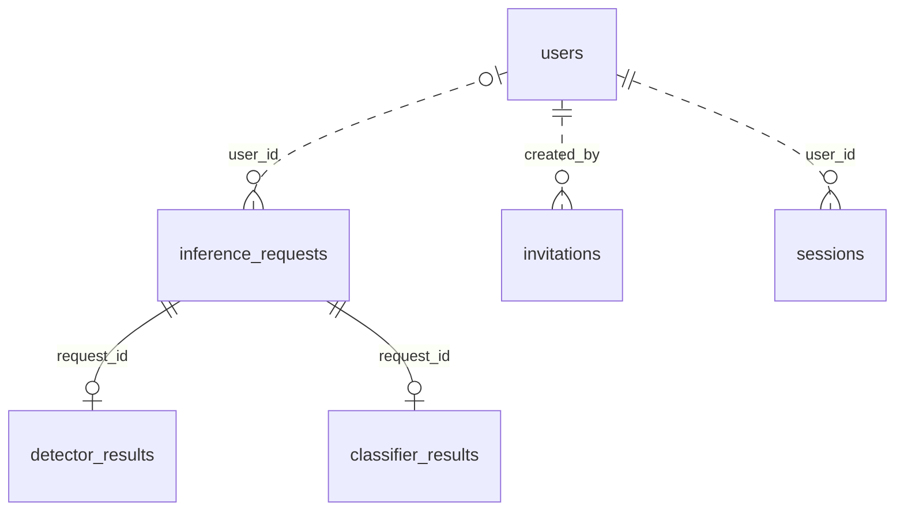

# DefectCatch 검사 이력 DB

PostgreSQL의 `inference` 데이터베이스는 **검사 이력 3개 테이블**과 **계정·인증 3개 테이블**로 구성된다. 검사 요청 ID로 탐지·분류 결과를 연결하고, 사용자 ID가 기록된 요청은 계정과 연결할 수 있다. 이 문서는 MLflow 실험 추적용 DB를 다루지 않는다.

## 테이블 6개와 역할

| 구분 | 테이블 | 역할 |
| --- | --- | --- |
| 검사 이력 | `inference_requests` | 검사 한 건의 파일명, 요청 시각, 최종 판정, 전체 처리 시간, 검토 정보, 요청 사용자 ID를 기록한다. |
| 검사 이력 | `detector_results` | 탐지 모델 이름·버전, 이상 점수, 불량 여부, 실행 시간을 기록한다. |
| 검사 이력 | `classifier_results` | 분류 모델 이름·버전, 불량 유형, 신뢰도, 불량 영역, 실행 시간을 기록한다. |
| 계정·인증 | `users` | 로그인에 사용하는 사용자 계정을 관리한다. 검사 요청의 `user_id`가 `users.id`를 참조한다. |
| 계정·인증 | `invitations` | 계정 생성을 위한 관리자 발급 일회용 초대를 관리한다. |
| 계정·인증 | `sessions` | 로그인 세션을 관리한다. 서비스가 요청 사용자를 식별하는 데 사용한다. |

6개 테이블의 컬럼과 제약조건은 PostgreSQL의 `\d` 출력으로 확인했다. 인증 및 검사 이력의 동작 설명은 프로젝트 아키텍처 문서를 기준으로 한다.

## 확인한 검사 이력 컬럼

| 테이블 | 컬럼 |
| --- | --- |
| `inference_requests` | `id`, `created_at`, `filename`, `model_choice`, `prediction`, `total_latency_ms`, `reviewed_label`, `reviewed_at`, `user_id` |
| `detector_results` | `request_id`, `model_name`, `model_version`, `anomaly_score`, `is_defect`, `latency_ms` |
| `classifier_results` | `request_id`, `model_name`, `model_version`, `defect_type`, `confidence`, `regions`, `latency_ms` |

- `prediction`은 `normal` 또는 `defect`다. `model_choice`는 `champion` 또는 `challenger`이며, 실제 모델 버전은 결과 테이블의 `model_version`에서 확인한다.
- `anomaly_score`는 탐지 모델의 이상 점수이며 불량 확률로 해석하지 않는다.
- `classifier_results.regions`는 JSONB이며 기본값은 빈 배열이다. `confidence`는 값이 있는 경우 0~1 범위다. `defect_type`은 값이 있는 경우 `brown`, `black`, `blue`, `surface` 중 하나다.

## 확인한 계정·인증 컬럼

| 테이블 | 컬럼 | 주요 제약조건 |
| --- | --- | --- |
| `users` | `id`, `email`, `password_hash`, `role`, `created_at` | `id`는 자동 생성 기본키다. `email`은 중복 불가이며, `role`은 `admin` 또는 `worker`다. `created_at` 기본값은 `now()`다. |
| `invitations` | `token_hash`, `email`, `created_by`, `expires_at`, `used_at`, `revoked_at` | `token_hash`는 기본키다. `created_by`는 필수이며 `users.id`를 참조한다. `used_at`과 `revoked_at`은 `NULL`을 허용한다. |
| `sessions` | `token_hash`, `user_id`, `expires_at` | `token_hash`는 기본키다. `user_id`는 필수이며 `users.id`를 참조한다. |

계정에는 비밀번호 해시를, 초대와 세션에는 토큰 해시를 저장한다. 초대는 만료·사용·취소 시각을 구분한다. `created_by` 외래키는 발급 계정의 존재만 보장한다. 관리자만 초대를 발급할 수 있다는 규칙은 서비스 동작이며, 이 외래키가 발급자의 역할까지 검사하는 것은 아니다.

## 테이블 관계



- **요청과 모델 결과.** 두 결과 테이블의 `request_id`는 기본키이자 `inference_requests.id`를 참조하는 외래키다. DB 제약조건상 요청 한 건에 탐지·분류 결과는 각각 **0개 또는 1개**다. 요청 행을 삭제하면 연결된 결과 행도 삭제된다.
- **요청과 사용자.** `inference_requests.user_id`는 `users.id`를 참조하며 `NULL`을 허용한다. 따라서 모든 검사 요청에 사용자 정보가 반드시 연결되는 것은 아니다.
- **사용자와 인증.** 초대 한 건은 발급 계정 한 개에, 세션 한 건은 로그인 계정 한 개에 연결된다. 계정이 삭제되면 해당 세션 행도 삭제된다(`ON DELETE CASCADE`). 검사 요청과 초대의 사용자 외래키에는 연쇄 삭제가 설정되어 있지 않다.

## 서비스에서 쓰는 방식

프로젝트 아키텍처 문서 기준으로, 탐지 모델이 불량으로 판정한 경우에만 분류 모델을 호출한다. DB 저장이 활성화되어 있으면 API는 응답 후 요청과 탐지 결과, 그리고 성공한 분류 결과를 하나의 트랜잭션에 저장한다. **분류 행이 없다는 사실만으로 정상이라고 판단할 수 없다.** 불량 검사에서도 분류에 실패하면 분류 행이 없을 수 있다.

검사 이력 API는 세션에서 조회자의 역할을 확인한다. 작업자는 본인 이력을, 관리자는 전체 이력을 조회한다.

## 스키마 파일 위치

| 파일 | 정의하는 내용 |
| --- | --- |
| [`001_inference_schema.sql`](./schema/001_inference_schema.sql) | 검사 요청, 탐지 결과, 분류 결과 테이블 |
| [`002_accounts.sql`](./schema/002_accounts.sql) | 계정, 초대, 세션과 검사 요청의 사용자 연결 |
| [`003_grafana_reader.sql`](./schema/003_grafana_reader.sql) | Grafana의 검사 이력 테이블 읽기 권한 |

SQL 파일은 스키마와 권한을 정의한다. 실제 적용 결과는 `psql` 조회로 확인한다.

## 발표용 설명

> 검사 요청 한 건을 기준으로 탐지 결과와 분류 결과를 같은 ID에 연결했습니다. 탐지 모델은 정상과 불량을 판정하고, 불량일 때만 분류 모델이 유형과 영역을 분석합니다. 사용자 ID가 기록된 요청은 계정과 연결되므로, 이력 화면에서 작업자는 본인 기록을 보고 관리자는 전체 기록을 볼 수 있습니다.

## 구조 확인 명령

`inference` DB의 `psql`에서 다음 명령으로 같은 스키마를 확인할 수 있다. 이 문서는 테이블 구조를 기준으로 하며, 개별 데이터 행이나 현재 운영 동작을 검증한 결과는 아니다.

```text
\dt public.*
\d public.inference_requests
\d public.detector_results
\d public.classifier_results
\d public.users
\d public.invitations
\d public.sessions
```
