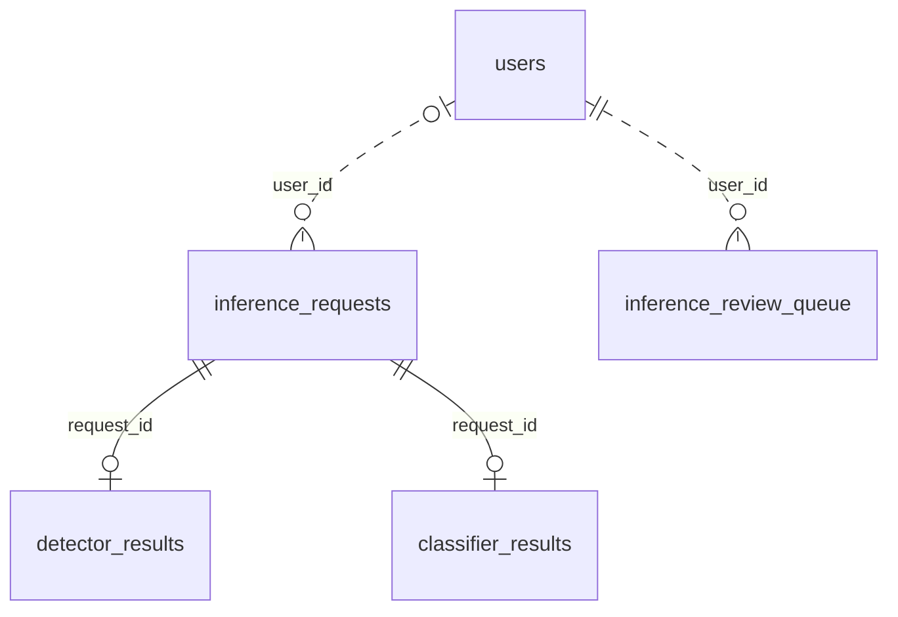

# DefectCatch 검사 이력·재검토 DB

`inference` 데이터베이스는 검사 결과, 계정·세션, 재검토 대기 메타데이터를 관리한다. MLflow 실험 추적용 `mlflow` DB의 구성·백업은 이 문서 범위에서 제외한다. 서비스가 어떤 결과를 저장하고 조회하는지는 [API 문서](../../../serving/api/README.md)와 [db.py](../../../serving/api/db.py)를 함께 확인한다.

이 문서는 저장소의 `001`~`004` SQL과 현재 서비스 코드를 대조한 설명이다. 운영 DB의 최신 구조·행을 이번 문서 수정에서 조회하지 않았다. 기존 문서의 6개 테이블 `\d` 확인 기록은 당시 결과이며, 재검토 추가 구조까지 운영 적용됐다는 증거로 확대하지 않는다.

## 테이블과 역할 — SQL 정의 기준

| 구분 | 테이블 | 역할 |
| --- | --- | --- |
| 최종 이력 | `inference_requests` | 요청 ID·사용자·시각·원래 판정·처리 시간과 작업자 최종 판단 |
| 모델 결과 | `detector_results` | 탐지 모델 URI·숫자 버전·이상 점수·불량 여부·처리 시간 |
| 모델 결과 | `classifier_results` | 분류 모델 URI·숫자 버전·유형·신뢰도·영역·처리 시간 |
| 계정·인증 | `users` | 계정·비밀번호 해시·admin/worker 역할 |
| 계정·인증 | `invitations` | 관리자 발급 초대의 토큰 해시·만료·사용·취소 시각 |
| 계정·인증 | `sessions` | 로그인 세션 토큰 해시·사용자·만료 시각 |
| 재검토 대기 | `inference_review_queue` | 최종 이력에 넣기 전 요청 메타데이터와 취소 상태 |

`001`과 `002`는 기존 6개 테이블을 정의하고 `004`가 대기 테이블과 검토 컬럼을 추가한다. SQL 정의를 합친 테이블 수는 7개이며 현재 운영 테이블 수는 별도 확인 대상이다. 테이블 3개를 데이터베이스 3개로 표현하지 않는다.

## 검사 결과·작업자 판단 컬럼

| 테이블 | SQL에 정의된 컬럼 |
| --- | --- |
| `inference_requests` | `id`, `created_at`, `filename`, `model_choice`, `prediction`, `total_latency_ms`, `reviewed_label`, `reviewed_at`, `user_id`, `review_status`, `reviewed_defect_type`, `reviewed_boxes` |
| `detector_results` | `request_id`, `model_name`, `model_version`, `anomaly_score`, `is_defect`, `latency_ms` |
| `classifier_results` | `request_id`, `model_name`, `model_version`, `defect_type`, `confidence`, `regions`, `latency_ms` |

**[확인 필요] 탐지 임계값 컬럼:** 현재 `db.py`는 `detector_results.threshold`를 INSERT·SELECT한다. 그러나 저장소의 `001`~`004` SQL에는 해당 컬럼 생성이 없다. 운영 `\d public.detector_results`와 마이그레이션 이력을 대조해야 한다. 위 표는 SQL 정의이며 `threshold`가 운영에서 없다고 확정한 것은 아니다. 이번 변경은 README만 수정하며 SQL을 임의로 추가·실행하지 않는다.

| 원래 모델 결과 | 작업자 판단 | 사용 방식 |
| --- | --- | --- |
| `prediction` | `reviewed_label` | 원래 정상·불량 유지, 이력 표시·판정 필터에는 작업자 판단 우선 |
| `classifier_results.defect_type` | `reviewed_defect_type` | 원래 유형 보존, 최종 정상은 표시 유형 없음 |
| `classifier_results.regions` | `reviewed_boxes` | 모델 원본 영역과 작업자 박스를 별도 보관 |
| 요청 `created_at` | `reviewed_at` | 검사 요청과 최종 판단 시각 구분 |

- `model_choice`는 `champion`·`challenger`다. 동적 Registry 조합은 `challenger`로 저장하므로 실제 버전은 각 결과의 `model_name`·`model_version`으로 확인한다.
- `anomaly_score`는 이상 점수이며 보정된 불량 확률이 아니다. `confidence`는 값이 있으면 0~1 범위다. 신뢰도 0.88은 현재 API 재검토 조건이 아니다.
- 결함 유형은 `brown`, `black`, `blue`, `surface`다. `regions`·`reviewed_boxes`는 JSONB이며 이미지 파일을 저장하는 컬럼이 아니다.
- 모델의 `regions`와 작업자의 `{x,y,w,h}` 박스는 생성 경로가 다르므로 같은 형식이라고 가정하지 않는다. API 변환 결과 `boxes`와 원본 영역도 구분한다.
- 최종 불량은 유형 필수·박스 선택이다. API는 입력 박스의 정수·양수 크기·이미지 경계를 검사하고 정상·취소의 유형·박스 입력을 거절한다. 이러한 API 검증 전체를 DB CHECK가 강제한다고 설명하지 않는다.

## 재검토 대기 컬럼과 관계

| 컬럼 | 정의·의미 |
| --- | --- |
| `request_id` | UUID 기본키. 대기 요청 식별자 |
| `user_id` | 필수, `users.id` 참조. 해당 사용자 삭제 시 연쇄 삭제 |
| `created_at` | 대기 기록 생성 시각. 확정 이력 생성 시 이 값을 요청 시각으로 전달 |
| `payload` | 요청·탐지·조건부 분류 결과의 JSON 객체. 원본 이미지 바이트는 포함하지 않음 |
| `cancelled_at` | 취소 시각. 취소 후 payload는 NULL |

미취소 행은 JSON 객체 payload가 있어야 하고 취소 행은 payload가 NULL이어야 한다. 대기 `request_id`에는 `inference_requests` 외래키가 없다. 재검토 시점에는 최종 이력 행이 아직 없기 때문이다.



- 모델 결과 `request_id`는 기본키이자 요청 외래키다. 요청당 탐지·분류는 DB 제약상 각각 0개 또는 1개이며, 요청 삭제 시 결과도 연쇄 삭제된다.
- `inference_requests.user_id`는 NULL 허용이다. 현재 인증된 API 요청은 사용자 ID를 넣지만 과거·직접 입력 데이터까지 필수 사용자라고 단정하지 않는다.
- `sessions.user_id`도 사용자 삭제 시 연쇄 삭제된다. `invitations.created_by`와 최종 이력의 사용자 외래키에는 연쇄 삭제가 지정돼 있지 않다.

## 계정·인증 컬럼

| 테이블 | 컬럼 |
| --- | --- |
| `users` | `id`, `email`, `password_hash`, `role`, `created_at` |
| `invitations` | `token_hash`, `email`, `created_by`, `expires_at`, `used_at`, `revoked_at` |
| `sessions` | `token_hash`, `user_id`, `expires_at` |

`users.id`는 identity 기본키, email은 중복 불가다. 비밀번호·초대·세션은 해시를 저장한다. 초대 발급자의 외래키는 계정 존재만 보장하며 관리자 여부는 API가 검사한다. 평문 비밀번호·토큰을 이 문서나 저장소에 기록하지 않는다.

## 저장 트랜잭션과 이력 조회 — 코드 기준

| 상황 | 저장·응답 |
| --- | --- |
| 일반 결과 | DB 저장 활성화 시 응답 후 요청·탐지·성공한 분류 결과를 한 트랜잭션에 저장. 실패는 로그·카운터에 기록되므로 200이 저장 보장은 아님 |
| 재검토 대상 | 불량이며 박스가 없거나 유효 유형이 없을 때 대기 메타데이터 저장. DB 비활성화·저장 실패는 503 |
| 정상·불량 확정 | 본인 대기 행을 `FOR UPDATE`로 잠금 → 원래 결과 INSERT → 검토 컬럼·상태 finalized 갱신 → 대기 행 DELETE. 같은 트랜잭션 |
| 취소 | 대기 행의 cancelled_at 기록·payload NULL. 최종 요청·모델 결과 행을 만들지 않음 |
| 재검사 | 새 요청·새 UUID로 처리. 이전 대기 건 정리는 실제 ID 대조가 필요한 후속 검증 |

`review_status`의 허용값은 `not_required`, `pending`, `finalized`, `cancelled`다. 일반 요청의 기본값은 `not_required`다. 현재 코드는 미확정·취소 데이터를 대기 큐로 관리하므로 모든 상태가 최종 이력 테이블에 기록된다고 해석하지 않는다. 대기 행은 cancelled_at 여부로 활성·취소를 구분한다.

최종 이력 조회는 `not_required`·`finalized`만 포함하고 작업자는 본인·관리자는 전체를 조회하도록 SQL을 구성한다. 판정에는 `COALESCE(reviewed_label, prediction)`을 사용한다. 원래 모델 판정은 응답의 `model_prediction`으로 따로 제공한다. 신뢰도 필터는 모델 confidence에 적용되며 작업자 확신도를 새로 저장하는 기능은 아니다.

**분류 행이 없다고 정상으로 단정하지 않는다.** 정상에서는 분류를 호출하지 않고, 불량에서도 분류 실패 시 원본 분류 행이 없을 수 있다. 재검토 확정 후에도 원래 분류 실행 성공 여부에 따라 결과 행의 유무가 달라진다.

재검사 성공·화면 삭제·새로고침이 이전 대기 건의 취소·삭제를 자동 보장하지 않는다. 기존 큐가 남는지는 아직 운영에서 재현하지 않았으며 코드상 가능성으로 남긴다.

## SQL 파일과 Grafana 조회 권한

| 파일 | 정의 |
| --- | --- |
| [001_inference_schema.sql](001_inference_schema.sql) | 빈 DB에서 검사 결과 3개 테이블·인덱스 생성 |
| [002_accounts.sql](002_accounts.sql) | 계정·초대·세션, 요청 user_id·인덱스 추가 |
| [003_grafana_reader.sql](003_grafana_reader.sql) | Grafana 조회 역할·권한 |
| [004_inference_review.sql](004_inference_review.sql) | 검토 컬럼·CHECK·대기 큐 추가 |

SQL 파일의 존재와 운영 적용 완료는 별개다. 기존 DB에 초기 SQL을 반복 실행하지 않는다. DB 변경은 실제 스키마·적용 이력을 확인한 뒤 별도 작업으로 수행한다.

`003`은 `grafana_reader`에 inference 접속·public 접근과 검사 이력 3개 테이블 SELECT를 부여한다. 계정·인증·대기 큐 조회 권한은 이 SQL에서 부여하지 않는다. 따라서 현재 재검토 대기 패널을 만들려면 SQL뿐 아니라 필요한 조회 권한도 검토해야 한다. 사용자·조직·대시보드 접근 설정은 [서비스 문서](../../service/README.md)의 Grafana 인증과 별개이며 DB SELECT 권한이 작업자별 행 격리를 자동 제공하지 않는다.

운영 패널에는 폐기한 0.88 조건이 남아 있다. 최종 이력 기반 모델 결과 집계와 현재 대기 큐 건수는 다르며, 패널 담당자와 의미·권한을 합의해 후속 정리한다.

## 운영에서 확인할 항목

아래는 이미 연결된 `inference` DB의 psql에서 실행할 읽기 전용 구조 확인 예시이며 이번 문서 수정 중 실행하지 않았다.

```text
\dt public.*
\d public.inference_requests
\d public.detector_results
\d public.classifier_results
\d public.inference_review_queue
\d public.users
\d public.invitations
\d public.sessions
\dp public.inference_review_queue
```

후속 검증은 요청 ID로 API·DB·이력 대조, 확정 후 큐 제거, 취소 행의 payload NULL, 재검사 전후 기존 큐 처리, threshold 컬럼의 실제 존재와 추가 경로를 확인하는 것이다. 운영 결과를 확인하기 전에는 이 문서의 코드 설명을 운영 검증 완료로 표기하지 않는다.
