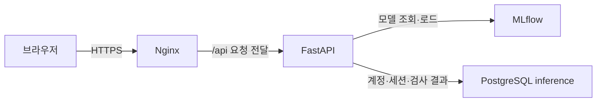

# 불량제로 검사 서비스

NHN Cloud에서 제조 표면 이미지의 이상 여부와 결함 유형을 판정합니다. 웹 화면에서 이미지를 검사하고 결과를 JSON으로 내려받거나 계정별 검사 이력을 조회할 수 있습니다. 관리자는 작업자를 초대하고 전체 이력을 조회하며, 작업자는 자신의 이력을 조회합니다.

## 구성과 요청 흐름



Nginx는 정적 HTML을 제공하고 `/api/` 접두어를 제거해 FastAPI에 요청을 전달합니다. FastAPI가 MLflow에서 모델을 불러와 서비스 서버에서 추론합니다. 현재 서비스 Compose의 `champion` 선택지는 탐지 모델 `models:/Zero-Defects/2`와 분류 모델 `models:/Zero-Defects-Classifier/1`을 사용합니다. 실제 선택지와 준비 상태는 `/api/models`로 확인합니다.

서비스용 `inference` DB에는 검사 결과와 계정·세션이 저장됩니다. MLflow는 별도 `mlflow` DB에 실험·등록 모델 메타데이터를 저장합니다. 운영 검증 당시 두 DB는 MLOps 인스턴스의 PostgreSQL에서 동작했습니다. DB 내부 구축·이전·백업은 별도 담당 범위이며 이 문서는 서비스의 연결과 저장 처리를 다룹니다.

| 파일 | 역할 |
| --- | --- |
| [compose.service.yaml](compose.service.yaml) | API·Nginx·Prometheus·Grafana 실행과 연결 설정 |
| [nginx/default.conf](nginx/default.conf) | TLS, HTML 제공, API·Grafana 프록시 |
| [monitoring/prometheus/prometheus.yml](monitoring/prometheus/prometheus.yml) | API 지표 수집 설정 |
| [웹 UI](../../serving/web/zerodefect-ui.html) | 검사·결과 다운로드·인증·이력 화면 |
| [추론 API 문서](../../serving/api/README.md) | API 계약과 인증·이력 저장 구조 |
| [DB 스키마](../mlops/db/) | 검사·계정 스키마와 마이그레이션 |
| [배포 워크플로](../../.github/workflows/deploy.yaml) · [배포 스크립트](../../.github/scripts/deploy_stack.sh) | 변경 감지, 이미지 빌드·배포, 상태 검사와 복구 |

## 배포와 접속

운영 파일은 `/opt/bulryangzero/service`에 둡니다. Compose 프로젝트 이름은 `ksdd2-mlops`입니다. Nginx는 `nginx/`, `web/`, `tls/`를 읽기 전용으로 마운트합니다. `web/`에는 저장소의 `serving/web/`가 배포됩니다. 시작 파일은 `zerodefect-ui.html`이고 CSS·JS는 `assets/zerodefect-ui/`에 분리돼 있습니다.

| 접근 경로 | 용도 |
| --- | --- |
| HTTPS `443` | 검사 화면과 API |
| HTTP `8080` | 기존 호스트 바인딩. 배포 스크립트는 서버 로컬의 `/api/ready`를 검사 |
| `127.0.0.1:9090`, `127.0.0.1:3000` | 서비스 서버의 Prometheus, Grafana |
| Nginx `/grafana/` | Grafana 프록시 |

팀 검증에는 자체 서명 IP 인증서를 사용했습니다. 브라우저는 인증서를 신뢰하는 환경에서 접속하며, CLI는 검증한 공개 PEM을 `curl --cacert`로 지정할 수 있습니다. 개인키와 DB 자격 증명은 서버에 보관합니다.

`main` 반영 시 GitHub Actions가 변경 범위에 따라 API 이미지 빌드·NCR 등록과 서비스 스택 배포를 수행합니다. UI·서비스 설정만 바뀌면 기존 이미지를 사용해 파일과 Compose 설정을 반영합니다. 워크플로의 수동 실행은 `target`으로 대상을 선택합니다. 배포 스크립트는 파일·이미지를 백업하고, 준비 검사가 실패하면 이전 구성으로 복구를 시도합니다. DB 데이터 복구는 별도입니다.

배포 스크립트는 소스 동기화에서 서버 전용 `.env`, `.env.prev`, `tls/`를 제외합니다. Grafana 외부 기준 주소는 현재 HTTPS의 `/grafana/`입니다. 배포 준비 검사 성공은 외부 로그인·실추론·DB 저장·패널 집계 검증을 대신하지 않습니다.

## 추론 DB 연결과 저장 검증

API는 Compose를 통해 `INFERENCE_DB_HOST`, `INFERENCE_DB_PORT`, `INFERENCE_DB_NAME`, `INFERENCE_DB_USER`, `INFERENCE_DB_PASSWORD`를 받습니다. 값은 배포 환경 파일에서 관리합니다. 모델 연결은 별도의 `MLFLOW_TRACKING_URI`, `MODEL_URI`, `CLASSIFIER_MODEL_URI`를 사용합니다.

일반 검사 결과는 DB 저장이 활성화되면 응답 이후 백그라운드에서 요청·탐지·성공한 분류 결과를 한 트랜잭션으로 저장합니다. 추론 200은 저장 완료 보장이 아닙니다.

재검토 조건은 **불량이며 박스가 없거나 유효한 결함 유형이 없는 경우**입니다. 0.88 기준은 폐기했습니다. 재검토 메타데이터는 `inference_review_queue`에 임시 저장하며 이 저장에 실패하거나 DB 저장 설정이 비활성화돼 있으면 503을 반환합니다. 정상·불량 확정 시 원래 모델 결과와 작업자 판단을 최종 이력에 저장하고 대기 행을 제거합니다. 취소는 대기 payload를 비우고 취소 시각만 남기며 최종 이력에는 넣지 않습니다. 이미지 파일 보관과 별개입니다.

`/api/ready`와 추론 200, DB 저장 성공은 분리해 검증합니다. 요청 ID로 요청·탐지·조건부 분류 행과 `reviewed_*` 컬럼, 사용자 이력을 대조합니다. 일반 저장 실패는 `Inference save failed` 로그와 `defectcatch_inference_save_total`로 확인합니다. 상세 계약은 [API 문서](../../serving/api/README.md)를 따릅니다.

## Grafana 인증·역할별 접근

1. 브라우저가 `/grafana/`에 서비스 세션 쿠키를 보냅니다.
2. Nginx는 내부 인증 요청으로 쿠키를 FastAPI `/auth/grafana-proxy`에 전달합니다.
3. FastAPI가 세션과 역할을 검사해 관리자·작업자이면 204와 `X-DefectCatch-User: defectcatch-{사용자 ID}`를 반환합니다.
4. Nginx가 이를 `X-WEBAUTH-USER`로 전달하며 브라우저의 Cookie·Authorization은 Grafana 요청에서 제거합니다.
5. Grafana는 신뢰 프록시의 사용자 이름 헤더로 인증합니다. 서비스의 `admin`·`worker` 역할 자체를 전달하지 않으므로 Grafana 내부 권한을 별도로 설정합니다.

| 설정 | 현재 값·역할 |
| --- | --- |
| 외부 기준 URL | `https://133.186.218.8/grafana/` |
| Nginx 인증망 IP | `172.30.250.2` — Grafana 신뢰 프록시 |
| Grafana 인증망 IP | `172.30.250.3` |
| Nginx 연결 대상 | `grafana-auth-backend:3000` |
| 인증 설정 | 프록시 인증 활성화, 익명 접근 비활성화, 신규 사용자 기본 역할 Viewer |
| UI 연결 | 작업자 `worker-dashboard`, 관리자 `admin-dashboard`. 관리자는 두 화면 선택 가능 |

2026-11-28 문서 정리에서 사용자 제공 서버 출력으로 주소·IP·환경변수·배포 Nginx 파일을 확인했습니다. 사용자는 비로그인 직접 접근 4xx 차단, 작업자 관리자 대시보드 접근 차단, 관리자 두 대시보드 조회를 확인했습니다. 정확한 비로그인 상태 코드와 시험 시각은 미기록입니다. 대시보드 접근 검증은 작업자별 데이터 행 격리나 패널 통계 정합성 검증과 구분합니다.

## 운영 확인과 장애 대응

서비스 서버에서 실행합니다.

```bash
sudo docker compose --project-directory /opt/bulryangzero/service -f /opt/bulryangzero/service/compose.service.yaml --env-file /opt/bulryangzero/service/.env ps
curl -fsS http://127.0.0.1:8080/api/ready
curl -fsS http://127.0.0.1:8080/api/models
curl -fsS http://127.0.0.1:9090/api/v1/targets
```

이전 운영 가이드의 검증 기록으로, 후보 API와 새 UI를 수동 반영한 환경에서 외부 HTTPS, 비로그인 401, 관리자 로그인과 계정 조회, 관리자·작업자 검사 저장을 확인했습니다. 운영에서 관리자·작업자 조회 범위의 직접 대조, 새 DB 복원과 전환, 최신 변경의 자동 배포 재현은 추가 검증 대상입니다.

| 증상 | 확인할 근거 |
| --- | --- |
| `502` 또는 `503` | API 모델 로딩 로그와 MLflow 연결. 시작 완료 후 502가 계속되면 Nginx upstream과 Docker DNS 확인 |
| 검사 성공 후 이력 누락 | DB 연결 대상, 저장 오류 로그, 실제 요청 ID와 사용자별 조회 범위 |
| `No such container` | SSH 접속 서버와 DB 컨테이너 이름. 기존 DB는 MLOps 서버에서 조회 |
| DB와 화면의 시각 차이 | DB의 UTC 시각을 한국 시간으로 변환해 요청 ID·파일명과 대조 |
| Grafana 패널 누락 | Prometheus 대상 상태, Grafana 외부 URL·프록시·패널 UID와 ID. 대시보드 보존은 볼륨 또는 JSON 내보내기로 확인 |

## 확인된 실행본과 후속 개선

- 사용자 제공 출력 기준 API 실행 이미지는 NCR `api:c6779ed`이며 기본 `/opt/bulryangzero/service/compose.service.yaml`로 생성됐습니다. Nginx 생성 라벨에는 기본 파일 외 `/home/infra-2/grafana-auth-backup.WSrn8h/apply.yaml`이 남아 있습니다. 추가 파일은 과거 테스트 API 이미지만 지정하며, 현재 API에 그 이미지가 적용된 상태는 아닙니다. 운영 파일 전체 해시 대조는 미실행입니다.
- 운영 `worker-dashboard`의 `low_conf=0.88` 변수·집계 SQL과 웹 iframe URL에 폐기한 기준이 남았습니다. 저장소 알림 생성 코드에도 같은 기준이 있으나 운영 규칙 적용 여부는 [확인 필요]입니다. 패널 담당자와 집계 의미를 맞춰 후속 정리하며 이번 문서 변경에서 패널·알림·서비스 코드는 수정하지 않습니다.
- 재검사는 새 요청 ID를 생성하고 UI 결과를 교체합니다. 이전 재검토 대기 건 정리 호출은 확인되지 않아 DB 잔존 가능성이 있습니다. 실제 요청 ID 대조 전에는 장애나 자동 정리 완료로 확정하지 않습니다.
- 위 접근 시험과 별도로 최신 검사·최종 정상·최종 불량·취소 결과의 운영 DB·화면 대조는 이번 문서 정리에서 수행하지 않았습니다.
