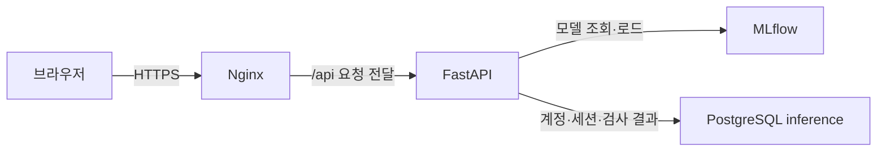

> 이 문서는 NHN 운영 당시(기능별 스택) 기록입니다. 현재 로컬 실행 구성은 루트 README의 "로컬 실행"을 참고하세요.

# 불량제로 검사 서비스

NHN Cloud에서 제조 표면 이미지의 이상 여부와 결함 유형을 판정합니다. 웹 화면에서 이미지를 검사하고 결과를 JSON으로 내려받거나 계정별 검사 이력을 조회할 수 있습니다. 관리자는 작업자를 초대하고 전체 이력을 조회하며, 작업자는 자신의 이력을 조회합니다.

## 구성과 요청 흐름



Nginx는 정적 HTML을 제공하고 `/api/` 접두어를 제거해 FastAPI에 요청을 전달합니다. FastAPI가 MLflow에서 모델을 불러와 서비스 서버에서 추론합니다. 현재 서비스 Compose의 `champion` 선택지는 탐지 모델 `models:/Zero-Defects/2`와 분류 모델 `models:/Zero-Defects-Classifier/1`을 사용합니다. 실제 선택지와 준비 상태는 `/api/models`로 확인합니다.

서비스용 `inference` DB에는 검사 결과와 계정·세션이 저장됩니다. MLflow는 별도 `mlflow` DB에 실험·등록 모델 메타데이터를 저장합니다. 운영 검증 당시 두 DB는 MLOps 인스턴스의 PostgreSQL에서 동작했습니다. 서비스 서버 측 DB로의 이전 절차와 검증 기준은 아래에 정리했습니다.

| 파일 | 역할 |
| --- | --- |
| [compose.service.yaml](compose.service.yaml) | API·Nginx·Prometheus·Grafana 실행과 연결 설정 |
| [nginx/default.conf.template](nginx/default.conf.template) | TLS, HTML 제공, API·Grafana 프록시 |
| [monitoring/prometheus/prometheus.yml](monitoring/prometheus/prometheus.yml) | API 지표 수집 설정 |
| [웹 UI](../../serving/web/index.html) | 검사·결과 다운로드·인증·이력 화면 |
| [추론 API 문서](../../serving/api/README.md) | API 계약과 인증·이력 저장 구조 |
| [DB 스키마](../mlops/db/) | 검사·계정 스키마와 마이그레이션 |
| [배포 워크플로](../../.github/workflows/deploy.yaml) · [배포 스크립트](../../.github/scripts/deploy_stack.sh) | 변경 감지, 이미지 빌드·배포, 상태 검사와 복구 |

## 배포와 접속

운영 파일은 `/opt/bulryangzero/service`에 둡니다. Compose 프로젝트 이름은 `ksdd2-mlops`입니다. Nginx는 `nginx/`, `web/`, `tls/`를 읽기 전용으로 마운트합니다. `web/`에는 저장소의 `serving/web/`가 배포됩니다.

| 접근 경로 | 용도 |
| --- | --- |
| HTTPS `443` | 검사 화면과 API |
| HTTP `8080` | 기존 호스트 바인딩. 배포 스크립트는 서버 로컬의 `/api/ready`를 검사 |
| `127.0.0.1:9090`, `127.0.0.1:3000` | 서비스 서버의 Prometheus, Grafana |
| Nginx `/grafana/` | Grafana 프록시 |

팀 검증에는 자체 서명 IP 인증서를 사용했습니다. 브라우저는 인증서를 신뢰하는 환경에서 접속하며, CLI는 검증한 공개 PEM을 `curl --cacert`로 지정할 수 있습니다. 개인키와 DB 자격 증명은 서버에 보관합니다.

`main` 반영 시 GitHub Actions가 변경 범위에 따라 API 이미지 빌드·NCR 등록과 서비스 스택 배포를 수행합니다. UI·서비스 설정만 바뀌면 기존 이미지를 사용해 파일과 Compose 설정을 반영합니다. 워크플로의 수동 실행은 `target`으로 대상을 선택합니다. 배포 스크립트는 파일·이미지를 백업하고, 준비 검사가 실패하면 이전 구성으로 복구를 시도합니다. DB 데이터 복구는 별도입니다.

**자동 배포 전 확인:** 현재 `rsync --delete` 제외 목록에 `tls/`가 없습니다. 인증서와 개인키의 보존 경로를 정한 뒤 배포·롤백 모두에서 확인합니다. Grafana의 외부 URL은 현재 HTTP `:8080` 기준이므로 HTTPS의 `/grafana/` 경로와 패널을 재검증합니다.

## 추론 DB 연결과 저장 검증

API는 Compose를 통해 `INFERENCE_DB_HOST`, `INFERENCE_DB_PORT`, `INFERENCE_DB_NAME`, `INFERENCE_DB_USER`, `INFERENCE_DB_PASSWORD`를 받습니다. 값은 배포 환경 파일에서 관리합니다. 모델 연결은 별도의 `MLFLOW_TRACKING_URI`, `MODEL_URI`, `CLASSIFIER_MODEL_URI`를 사용합니다.

서비스 서버에 PostgreSQL을 배치할 경우 기존 `inference` DB를 백업·복원하고, API와 새 PostgreSQL을 같은 Docker 네트워크에 연결해 서비스 이름으로 접근합니다. 검사 이력뿐 아니라 사용자, 초대, 세션과 권한도 복원 검증 범위에 포함합니다. 스키마를 포함한 덤프를 복원한 경우 초기 SQL을 다시 적용하지 않습니다. 기존 원본 DB를 유지한 채 전환을 검증하고, 새 DB에 쓰기가 생긴 뒤에는 두 DB의 데이터 차이를 확인한 후 복구 방향을 결정합니다.

검사 저장은 응답 이후 백그라운드에서 이루어집니다. `/api/ready`와 추론 응답의 200은 각각 API 준비·추론 성공을 보여줍니다. **저장 성공은 실제 검사 요청 ID를 기준으로 DB에서 확인합니다.** 요청 행과 탐지 행, 분류가 실행된 경우 분류 행, `user_id`, 이력 화면을 대조합니다. 실패 시 API 로그의 `Inference save failed`와 `defectcatch_inference_save_total` 지표를 봅니다.

## 운영 확인과 장애 대응

서비스 서버에서 실행합니다.

```bash
sudo docker compose -f /opt/bulryangzero/service/compose.service.yaml ps
curl -fsS http://127.0.0.1:8080/api/ready
curl -fsS http://127.0.0.1:8080/api/models
curl -fsS http://127.0.0.1:9090/api/v1/targets
```

후보 API와 새 UI를 수동 반영한 환경에서 외부 HTTPS, 비로그인 401, 관리자 로그인과 계정 조회, 관리자·작업자 검사 저장을 확인했습니다. 운영에서 관리자·작업자 조회 범위의 직접 대조, 새 DB 복원과 전환, 최신 변경의 자동 배포 재현은 추가 검증 대상입니다.

| 증상 | 확인할 근거 |
| --- | --- |
| `502` 또는 `503` | API 모델 로딩 로그와 MLflow 연결. 시작 완료 후 502가 계속되면 Nginx upstream과 Docker DNS 확인 |
| 검사 성공 후 이력 누락 | DB 연결 대상, 저장 오류 로그, 실제 요청 ID와 사용자별 조회 범위 |
| `No such container` | SSH 접속 서버와 DB 컨테이너 이름. 기존 DB는 MLOps 서버에서 조회 |
| DB와 화면의 시각 차이 | DB의 UTC 시각을 한국 시간으로 변환해 요청 ID·파일명과 대조 |
| Grafana 패널 누락 | Prometheus 대상 상태, Grafana 외부 URL·프록시·패널 UID와 ID. 대시보드 보존은 볼륨 또는 JSON 내보내기로 확인 |

